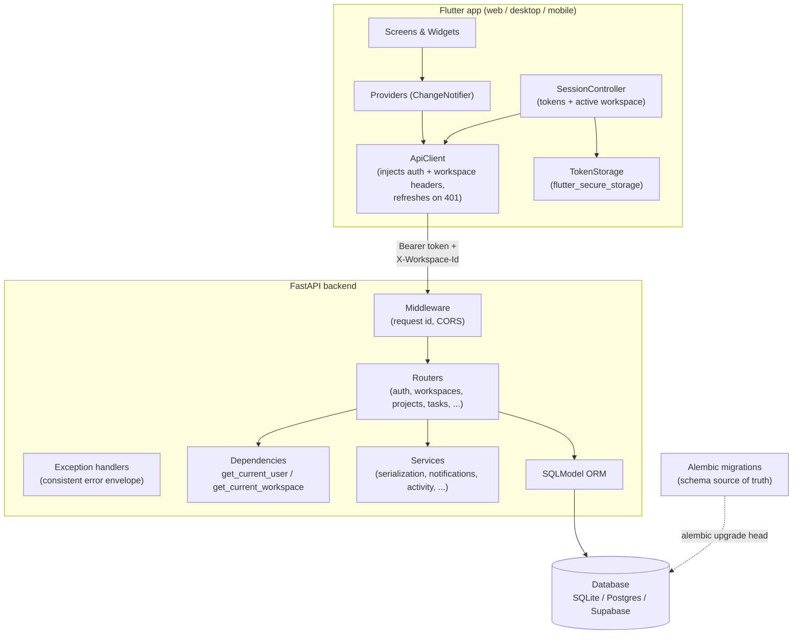
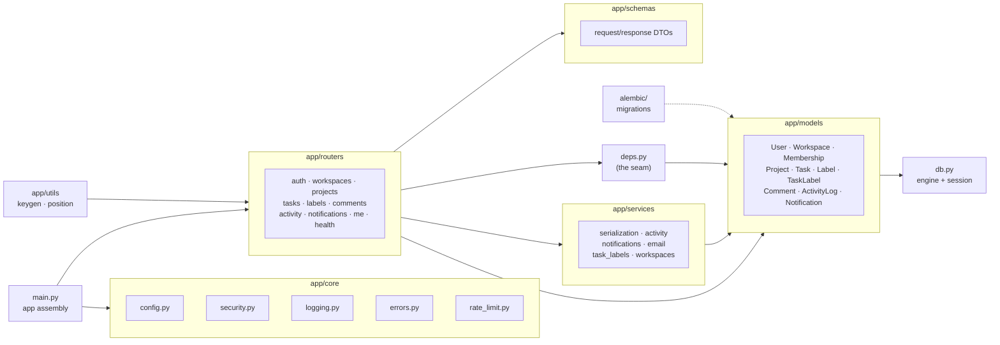
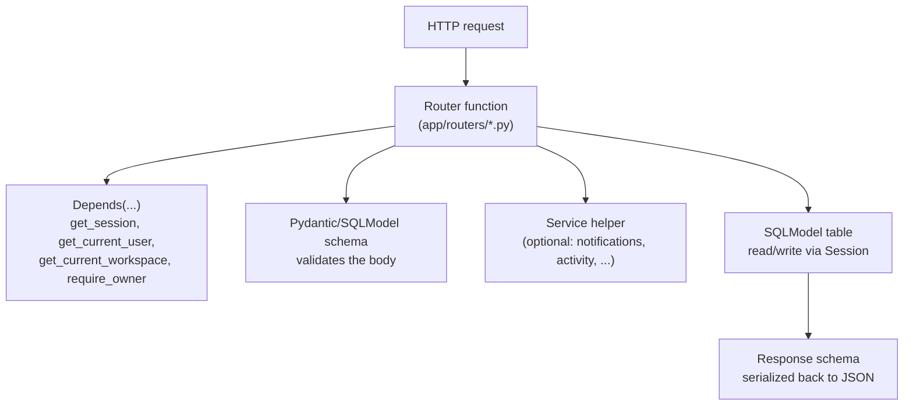
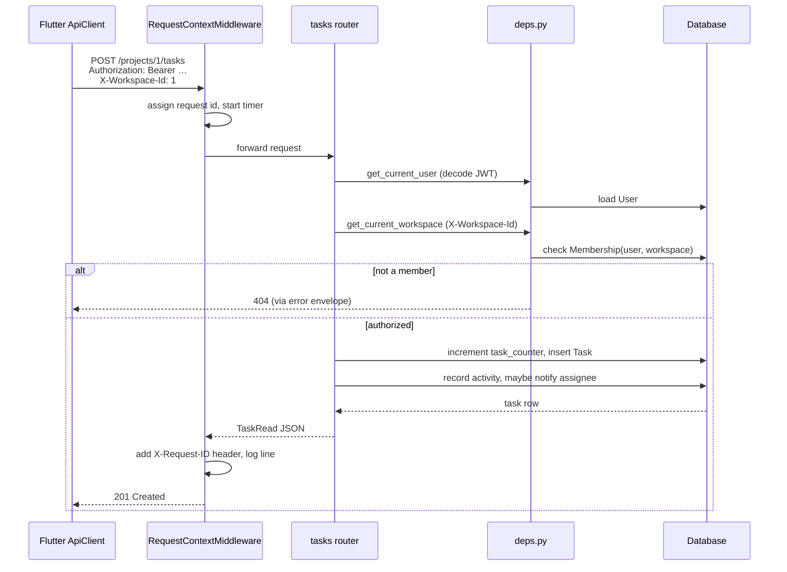
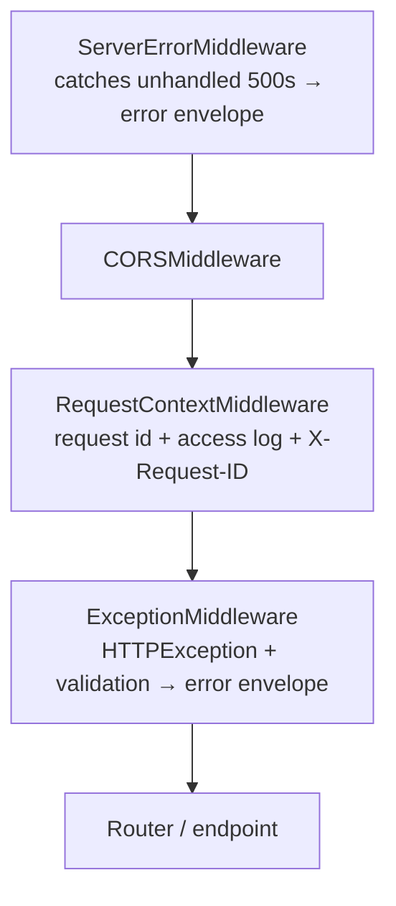
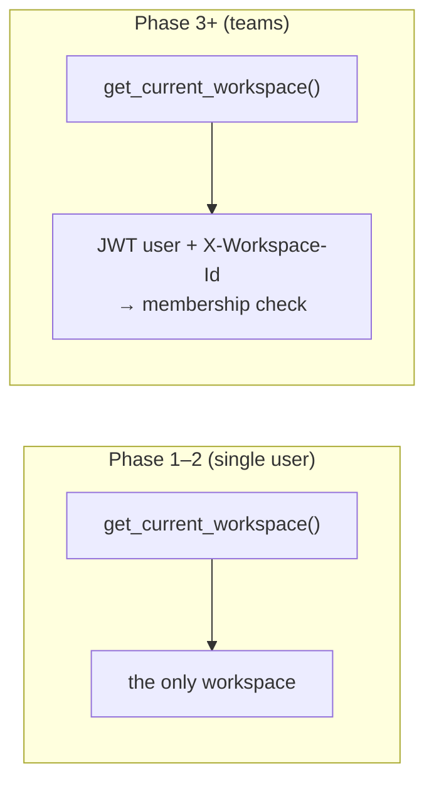
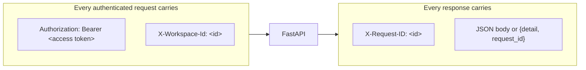

# 3. Architecture

This chapter is the map. It shows the major components, how a request travels
end to end, and the one design idea — the **workspace seam** — that shapes the
whole backend. Deep dives for each component are linked inline.

## High-level system design

Korvexa is a classic two-tier app: a Flutter client talks to a FastAPI server
over HTTP/JSON, and the server persists to a SQL database.

The client never talks to the database directly. It holds tokens and the active
workspace id, and attaches them to every request. The server decides — on every
request — *who* you are and *which workspace* you're acting in, then enforces
that you're a member of it.

## Backend component map

The backend is organized by responsibility. Each folder is a layer:

Chapter map for these components:

- `main.py`, `core/*`, `db.py` → [Chapter 5](05-backend-foundation.md)
- `models/*`, `alembic/*` → [Chapter 6](06-data-model-and-migrations.md)
- `deps.py`, `security.py`, auth & workspaces routers → [Chapter 7](07-auth-and-multitenancy.md)
- projects/tasks/me routers, serialization, utils → [Chapter 8](08-projects-tasks-board.md)
- comments/labels/activity → [Chapter 9](09-comments-labels-activity.md)
- notifications, assignments, email → [Chapter 10](10-assignments-notifications.md)

## The layered pattern inside the backend

Every feature follows the same vertical slice:

- **Routers** are thin: they validate input, call `Depends` for auth/tenancy,
  do the query, and return a response schema.
- **Schemas** ([`app/schemas`](../backend/app/schemas)) are the request/response
  contracts — separate from the ORM tables so the API surface is deliberate.
- **Services** ([`app/services`](../backend/app/services)) hold logic shared by
  several routers (serializing tasks with their labels, writing activity
  entries, creating notifications) to keep routers small.
- **Models** ([`app/models`](../backend/app/models)) are the SQLModel tables.

## Request lifecycle

Here is what a typical authenticated call — "create a task" — passes through:

The two `Depends` calls are the heart of the security model: **who** (JWT) and
**which workspace** (header + membership check). They are covered in detail in
[Chapter 7](07-auth-and-multitenancy.md).

## Middleware & error handling layers

FastAPI/Starlette wrap the router in a stack. Korvexa configures it (in
[`app/main.py`](../backend/app/main.py)) so that, from outermost to innermost:

Two consequences worth remembering:

- Every response — success or error — leaves with an `X-Request-ID` header, and
  every error body carries a matching `request_id`. See [Chapter 5](05-backend-foundation.md#error-envelope--request-ids--errorspy).
- Because `RequestContextMiddleware` sits *outside* the exception handlers, the
  request id is available both to the handlers and to the access log line.

## The "team-later" seam (why the design scales)

Every table that holds user data has a `workspace_id`. A `memberships` table
records which users belong to which workspace and with what role. All data
access flows through **one dependency**, `get_current_workspace`.

- In **Phase 1–2** the app was single-user: `get_current_workspace` returned
  "the only workspace that exists".
- In **Phase 3** the app became multi-tenant by **rewriting only that
  dependency** to resolve the user from a JWT and the workspace from the
  `X-Workspace-Id` header, enforcing membership. No router code changed — the
  dependency still returns a `Workspace`.

This is the single most important architectural idea in the project. It is
explored fully — with the actual before/after code — in
[Chapter 7](07-auth-and-multitenancy.md).

## Data flow: frontend ↔ backend contract

The Flutter `ApiClient` sets those two request headers from the
`SessionController`, and on a `401` it transparently calls `/auth/refresh` and
replays the request once (see [Chapter 11](11-frontend-architecture.md)).

---

Previous: [Chapter 2 — Project Overview](02-project-overview.md) ·
Next: [Chapter 4 — Getting Started](04-getting-started.md)
