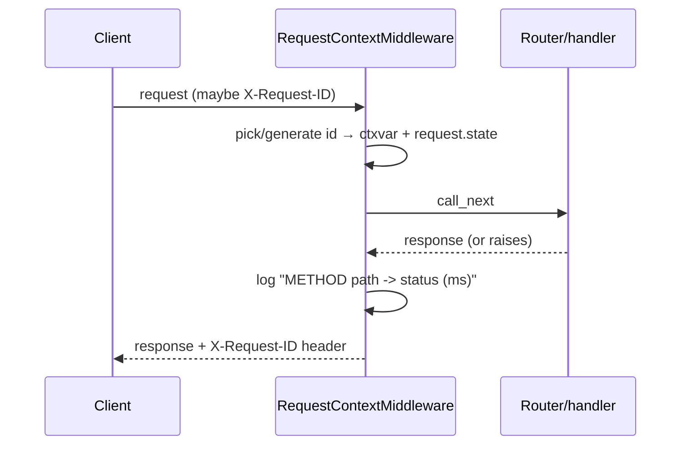

# 5. Backend Foundation

This chapter covers the plumbing every request touches before any feature logic
runs: application assembly, configuration, the database engine/session, request
logging, the error envelope, and rate limiting.

Files covered:
[`main.py`](../backend/app/main.py),
[`core/config.py`](../backend/app/core/config.py),
[`db.py`](../backend/app/db.py),
[`core/logging.py`](../backend/app/core/logging.py),
[`core/errors.py`](../backend/app/core/errors.py),
[`core/rate_limit.py`](../backend/app/core/rate_limit.py).

## Application assembly — `main.py`

[`app/main.py`](../backend/app/main.py) builds the FastAPI app and wires
everything together. The order of operations matters:

```python
settings = get_settings()
configure_logging()                       # 1. logging first

app = FastAPI(title="Korvexa API", version="1.0.0", description=..., openapi_tags=[...])

app.add_middleware(RequestContextMiddleware)   # 2. request id + access log
register_exception_handlers(app)               # 3. consistent error envelope
app.state.limiter = limiter                     # 4. rate limiter handle

@app.exception_handler(RateLimitExceeded)       # 5. 429 → same envelope
async def _rate_limit_handler(request, exc): ...

app.add_middleware(CORSMiddleware, ...)         # 6. CORS (outermost user MW)

app.include_router(health.router)               # 7. mount routers
app.include_router(auth.router)
# ... workspaces, projects, tasks, labels, comments, activity, notifications, me
```

Key points:

- `openapi_tags` gives the `/docs` page grouped, described sections (auth,
  workspaces, projects, …). This is the OpenAPI polish added in Phase 4.
- The FastAPI `description` documents the auth model and error envelope right in
  the docs UI.
- Router include order is cosmetic (it affects `/docs` grouping), not routing.

The **ten routers** mounted here are the entire API surface. Each has its own
deep-dive chapter — see the [API Reference](14-api-reference.md) for the
complete endpoint list.

## Configuration — `config.py`

[`app/core/config.py`](../backend/app/core/config.py) defines a single
`Settings` class using **pydantic-settings**. Every field can be overridden by
an environment variable of the same name (case-insensitive) or a `.env` file.

```python
class Settings(BaseSettings):
    model_config = SettingsConfigDict(env_file=".env", env_file_encoding="utf-8", extra="ignore")

    environment: str = "development"
    database_url: str = "sqlite:///./korvexa.db"
    cors_origins: list[str] = ["*"]

    secret_key: str = "dev-secret-change-me"
    algorithm: str = "HS256"
    access_token_expire_minutes: int = 30
    refresh_token_expire_minutes: int = 60 * 24 * 30   # 30 days
    bcrypt_rounds: int = 12

    rate_limit_auth: str = "10/minute"

    @property
    def is_sqlite(self) -> bool:
        return self.database_url.startswith("sqlite")
```

`get_settings()` is wrapped in `@lru_cache`, so `Settings` is parsed once and
the same instance is reused everywhere. The full table of variables — defaults,
required-vs-optional, and effect — is in the
[Configuration Reference](15-configuration-reference.md).

The `is_sqlite` helper is used in two places that need to special-case SQLite:
the DB engine (below) and Alembic (see [Chapter 6](06-data-model-and-migrations.md)).

## Database engine & session — `db.py`

[`app/db.py`](../backend/app/db.py) creates the SQLAlchemy engine and the
per-request session dependency. It deliberately uses **synchronous** SQLAlchemy
so one code path works across SQLite, Postgres, and Supabase.

```python
_connect_args = {"check_same_thread": False} if settings.is_sqlite else {}
engine = create_engine(settings.database_url, echo=False, connect_args=_connect_args)

if settings.is_sqlite:
    @event.listens_for(engine, "connect")
    def _set_sqlite_pragma(dbapi_connection, _connection_record) -> None:
        cursor = dbapi_connection.cursor()
        cursor.execute("PRAGMA foreign_keys=ON")
        cursor.close()

def get_session() -> Iterator[Session]:
    with Session(engine) as session:
        yield session
```

Two SQLite-specific details that keep behavior identical to Postgres:

- `check_same_thread=False` lets the connection be used across threads (needed
  by the dev server and the test client).
- The `PRAGMA foreign_keys=ON` event turns on **foreign-key enforcement**, which
  SQLite disables by default. Without it, `ON DELETE CASCADE` and FK violations
  would behave differently than on Postgres. With it, cascades (e.g. deleting a
  project deletes its tasks) work the same everywhere.

`get_session` is a FastAPI dependency: routers declare
`session: Session = Depends(get_session)` and get a session that is opened and
closed per request. In tests this dependency is overridden to point at a
throwaway database — see [Chapter 16](16-testing.md).

## Request context & logging — `logging.py`

[`app/core/logging.py`](../backend/app/core/logging.py) provides structured
logging keyed by a **per-request id**, via a `ContextVar` and a middleware.

```python
request_id_ctx: ContextVar[str] = ContextVar("request_id", default="-")

class RequestContextMiddleware(BaseHTTPMiddleware):
    async def dispatch(self, request, call_next):
        request_id = request.headers.get("X-Request-ID") or uuid.uuid4().hex
        request.state.request_id = request_id          # survives to the 500 handler
        token = request_id_ctx.set(request_id)          # visible to log lines
        start = time.perf_counter()
        try:
            response = await call_next(request)
        except Exception:
            logger.exception("%s %s -> unhandled error ...", ...)
            raise
        finally:
            request_id_ctx.reset(token)
        response.headers["X-Request-ID"] = request_id
        logger.info("%s %s -> %s (%.1fms)", request.method, request.url.path,
                    response.status_code, elapsed_ms)
        return response
```

How it fits together:

- If the client sends an `X-Request-ID`, it's honored (useful for tracing a call
  across systems); otherwise a new hex id is generated.
- The id is stored **two ways**: in `request_id_ctx` (so any log line during the
  request automatically includes it, via `_RequestIdFilter`) and on
  `request.state` (so the 500 handler, which runs in an outer middleware after
  the context var is reset, can still read it — see the note in
  [errors.py](#error-envelope--request-ids--errorspy)).
- `configure_logging()` installs a formatter that prints the id on every line:
  `2026-… INFO [korvexa] [req:ab12…] GET /projects -> 200 (3.4ms)`.



## Error envelope & request ids — `errors.py`

[`app/core/errors.py`](../backend/app/core/errors.py) registers three exception
handlers so **every** failure returns the same JSON shape:

```json
{ "detail": "<message>", "request_id": "<id>" }
```

Validation failures add an `errors` array. The handlers:

```python
def _request_id(request):  # prefer request.state, fall back to the ctxvar
    return getattr(request.state, "request_id", None) or request_id_ctx.get()

def _payload(request, detail, **extra):
    return {"detail": detail, "request_id": _request_id(request), **extra}

# StarletteHTTPException  -> {detail, request_id}     (keeps exc.status_code)
# RequestValidationError  -> 422 {detail:"Validation error", errors:[...], request_id}
# Exception (unhandled)   -> 500 {detail:"Internal server error", request_id}
```

Design choices:

- **`detail` is kept as the primary message.** That's FastAPI's convention and
  what the Flutter `ApiClient` reads, so standardizing the envelope didn't break
  existing clients — it only *added* `request_id` (and `errors`).
- The validation handler strips non-JSON-serializable bits from Pydantic's error
  objects (keeping `loc`, `msg`, `type`).
- The unhandled-exception handler is registered for bare `Exception`, which
  Starlette routes to the outermost `ServerErrorMiddleware`. Because that runs
  *after* `RequestContextMiddleware` has reset the context var, the handler reads
  the id from `request.state` instead — that's why the middleware stashes it
  there.

The net effect for operators: a user reports "I got an error, request id
`ab12…`", and you grep the logs for `req:ab12…` to find the exact line.

## Rate limiting — `rate_limit.py`

[`app/core/rate_limit.py`](../backend/app/core/rate_limit.py) is tiny:

```python
from slowapi import Limiter
from slowapi.util import get_remote_address

limiter = Limiter(key_func=get_remote_address)
```

It creates a shared **slowapi** limiter keyed by client IP. It's applied to the
two auth endpoints as decorators (in [`routers/auth.py`](../backend/app/routers/auth.py)):

```python
@router.post("/register")
@limiter.limit(settings.rate_limit_auth)   # default "10/minute"
def register(request: Request, ...): ...
```

When the limit is exceeded, slowapi raises `RateLimitExceeded`, which `main.py`
catches and returns as a `429` in the standard envelope:

```python
@app.exception_handler(RateLimitExceeded)
async def _rate_limit_handler(request, exc):
    return JSONResponse(status_code=429, content={
        "detail": f"Rate limit exceeded: {exc.detail}",
        "request_id": request_id_ctx.get(),
    })
```

The limit string is configurable via `RATE_LIMIT_AUTH`. In the test suite the
limiter is globally disabled (and re-enabled only for the rate-limit test) so it
doesn't interfere — see [Chapter 16](16-testing.md).

## How these pieces are exercised

- `configure_logging()` and the middleware run on every request.
- The error handlers are proven by
  [`tests/test_hardening.py`](../backend/tests/test_hardening.py): error
  envelope shape, the `X-Request-ID` header (including echoing an inbound one),
  and the 429 from rate limiting.

---

Previous: [Chapter 4 — Getting Started](04-getting-started.md) ·
Next: [Chapter 6 — Data Model & Migrations](06-data-model-and-migrations.md)
