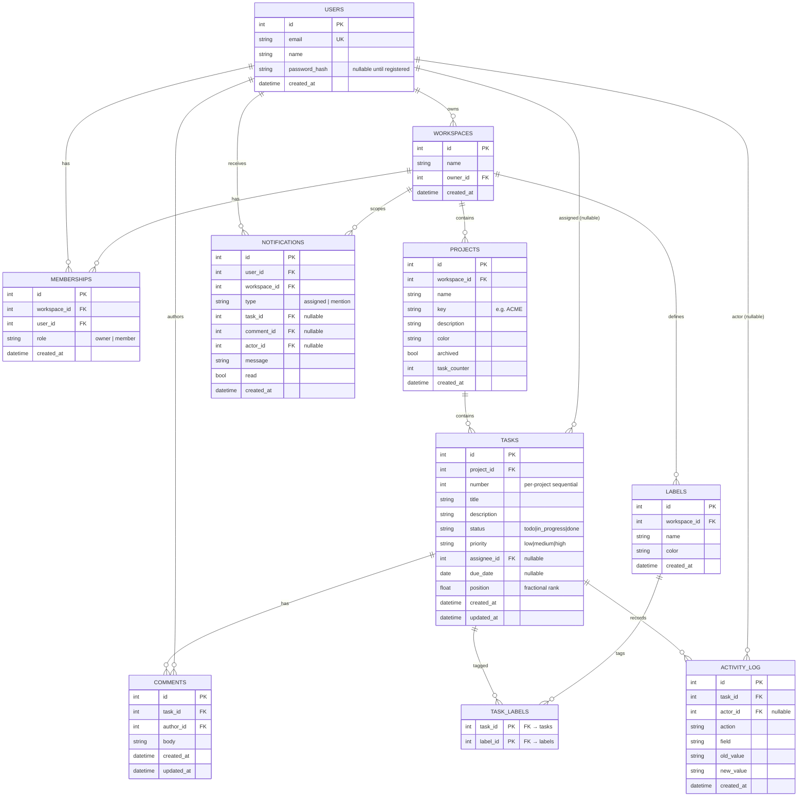
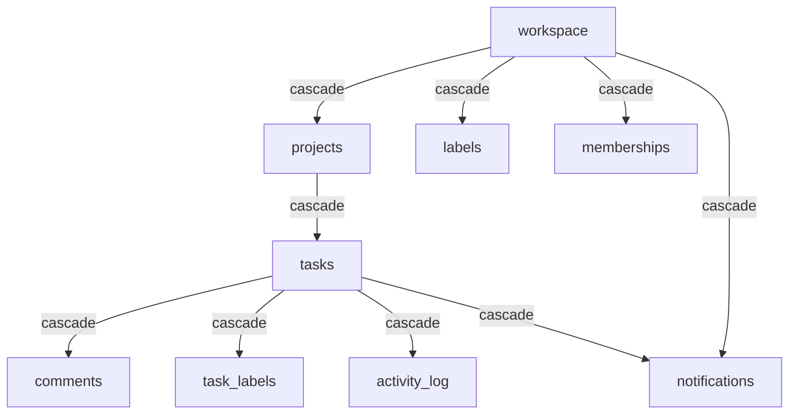
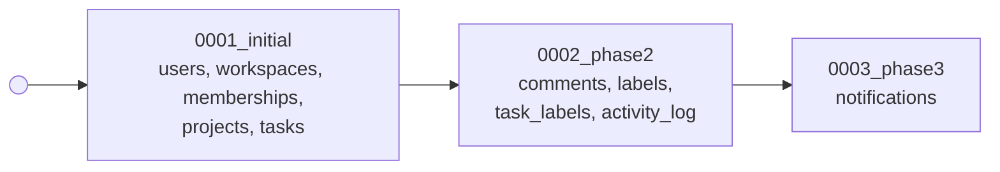

# 6. Data Model & Migrations

This chapter is the reference for Korvexa's persistent state: the tables, how
they relate, the constraints that enforce correctness, and how the schema is
built and evolved with Alembic.

Files covered: everything in
[`app/models/`](../backend/app/models) and
[`alembic/`](../backend/alembic).

## Models are SQLModel classes

Each table is a `SQLModel` subclass with `table=True`. SQLModel unifies
SQLAlchemy (the ORM/table) and Pydantic (validation), so one class defines the
columns. Example ([`models/task.py`](../backend/app/models/task.py)):

```python
class Task(SQLModel, table=True):
    __tablename__ = "tasks"
    __table_args__ = (UniqueConstraint("project_id", "number", name="uq_task_project_number"),)

    id: Optional[int] = Field(default=None, primary_key=True)
    project_id: int = Field(foreign_key="projects.id", nullable=False, index=True)
    number: int                       # sequential per project → "ACME-42"
    title: str = Field(max_length=500)
    status: str = Field(default=TaskStatus.todo.value, max_length=20, index=True)
    priority: str = Field(default=TaskPriority.medium.value, max_length=20, index=True)
    assignee_id: Optional[int] = Field(default=None, foreign_key="users.id", index=True)
    due_date: Optional[date] = None
    position: float = Field(default=0.0)   # fractional rank for ordering
    created_at: datetime = Field(default_factory=_utcnow)
    updated_at: datetime = Field(default_factory=_utcnow)
```

A design choice worth noting: **enums are stored as strings**. `TaskStatus` and
`TaskPriority` are Python `str`-enums, but the column type is `str(max_length=20)`
with the enum's `.value` as default. This keeps the schema portable (no native
DB enum types that differ between SQLite and Postgres) while the API layer still
validates against the enum via the schemas (see [Chapter 8](08-projects-tasks-board.md)).

All model files register themselves through
[`models/__init__.py`](../backend/app/models/__init__.py), which imports every
model so `SQLModel.metadata` is fully populated — Alembic and the tests rely on
this.

## The tables

| Table | Model file | Purpose | Introduced |
|-------|-----------|---------|-----------|
| `users` | [`user.py`](../backend/app/models/user.py) | Accounts (email, name, `password_hash` nullable) | Phase 0/1 |
| `workspaces` | [`workspace.py`](../backend/app/models/workspace.py) | Tenants; each has an owner | Phase 0/1 |
| `memberships` | [`membership.py`](../backend/app/models/membership.py) | User↔workspace with a role | Phase 0/1 |
| `projects` | [`project.py`](../backend/app/models/project.py) | Projects within a workspace | Phase 1 |
| `tasks` | [`task.py`](../backend/app/models/task.py) | Tasks within a project | Phase 1 |
| `comments` | [`comment.py`](../backend/app/models/comment.py) | Task comments | Phase 2 |
| `labels` | [`label.py`](../backend/app/models/label.py) | Workspace-scoped labels | Phase 2 |
| `task_labels` | [`label.py`](../backend/app/models/label.py) | Task↔label join | Phase 2 |
| `activity_log` | [`activity.py`](../backend/app/models/activity.py) | Per-task audit trail | Phase 2 |
| `notifications` | [`notification.py`](../backend/app/models/notification.py) | In-app notifications | Phase 3 |

## Entity–relationship diagram



## Constraints that enforce correctness

The schema encodes several invariants so bad states are impossible at the DB
level, not just in code:

| Constraint | Table | Meaning |
|-----------|-------|---------|
| `email` unique | `users` | One account per email |
| `uq_membership_workspace_user` | `memberships` | A user joins a workspace at most once |
| `uq_project_workspace_key` | `projects` | Project keys are unique *within* a workspace |
| `uq_task_project_number` | `tasks` | Task numbers are unique *within* a project |
| `uq_label_workspace_name` | `labels` | Label names are unique *within* a workspace |
| composite PK `(task_id, label_id)` | `task_labels` | A label is attached to a task at most once |

Note how uniqueness is **scoped to the parent** (workspace or project), not
global — two different workspaces can each have a `bug` label or an `ACME`
project. This is the tenancy model expressed in the schema.

## Cascades

Foreign keys use `ON DELETE CASCADE` down the ownership tree, so deleting a
parent cleans up its children in one operation:



For example, deleting a project deletes its tasks, and each task's comments,
labels links, and activity. This is why the SQLite FK pragma
([Chapter 5](05-backend-foundation.md#database-engine--session--dbpy)) matters —
without it, SQLite would silently skip the cascade.

## Fields worth understanding

- **`projects.task_counter`** — a monotonically increasing integer. When a task
  is created, the counter is incremented and its value becomes the task's
  `number`. Combined with `projects.key` it forms the human key `ACME-42`. Using
  a stored counter (rather than `MAX(number)+1`) keeps numbers stable even after
  deletions. See [Chapter 8](08-projects-tasks-board.md).
- **`tasks.position`** — a **fractional rank** (a float). Ordering within a
  column is by `position`; inserting between two cards uses the midpoint of
  their positions, so reordering writes exactly one row. See
  [`utils/position.py`](../backend/app/utils/position.py) and
  [Chapter 8](08-projects-tasks-board.md#reordering-fractional-ranks).
- **`users.password_hash` is nullable** — a user can exist without a password.
  This supports **invite placeholders**: inviting an unknown email creates a
  passwordless user that is "claimed" when that person registers. See
  [Chapter 7](07-auth-and-multitenancy.md#invites).
- **`activity_log.actor_id` / `notifications.actor_id` are nullable** — the
  actor is the user who caused the event; nullable for robustness and for
  system-generated entries.

## Migrations — Alembic

The schema is **built and evolved exclusively by Alembic migrations**. The
production/dev/test paths all run `alembic upgrade head`; the code never calls
`create_all` except in the throwaway `--reset` path of the demo seeder.

### Migration files

Migrations live in [`alembic/versions/`](../backend/alembic/versions) and form a
linear chain:



Each revision declares its `down_revision` to chain to the previous one, and has
`upgrade()` / `downgrade()` functions of raw `op.create_table(...)` calls. They
are **hand-written**, not autogenerated, so they're explicit and reviewable.

> `users.password_hash` was created *nullable in the very first migration*, so
> turning on real auth in Phase 3 needed **no schema change** to the users table
> — only the new `notifications` table (migration 0003).

### `env.py` — how Alembic finds the schema and the database

[`alembic/env.py`](../backend/alembic/env.py) does three important things:

```python
import app.models                     # ensure every table is registered
target_metadata = SQLModel.metadata   # what to compare/build against

# URL precedence: an explicit test URL, else application settings.
_url = config.attributes.get("configured_url") or get_settings().database_url
config.set_main_option("sqlalchemy.url", _url)

# SQLite can't ALTER TABLE normally; batch mode rebuilds tables. Postgres ignores it.
render_as_batch = connection.engine.url.get_backend_name() == "sqlite"
```

- It imports `app.models` so `SQLModel.metadata` knows every table.
- The database URL comes from application settings by default, but tests inject
  a throwaway SQLite URL via `config.attributes["configured_url"]` — this is how
  each test builds its own database (see [Chapter 16](16-testing.md)).
- `render_as_batch` for SQLite enables "batch mode", which emulates
  `ALTER TABLE` by rebuilding the table — keeping one migration script valid on
  both SQLite and Postgres.

### Common Alembic commands

```bash
alembic upgrade head          # build/upgrade to the latest schema
alembic downgrade -1          # roll back one migration
alembic current               # show the applied revision
alembic history               # list the chain
alembic revision -m "msg"     # scaffold a new (empty) migration
```

---

Previous: [Chapter 5 — Backend Foundation](05-backend-foundation.md) ·
Next: [Chapter 7 — Authentication & Multi-Tenancy](07-auth-and-multitenancy.md)
