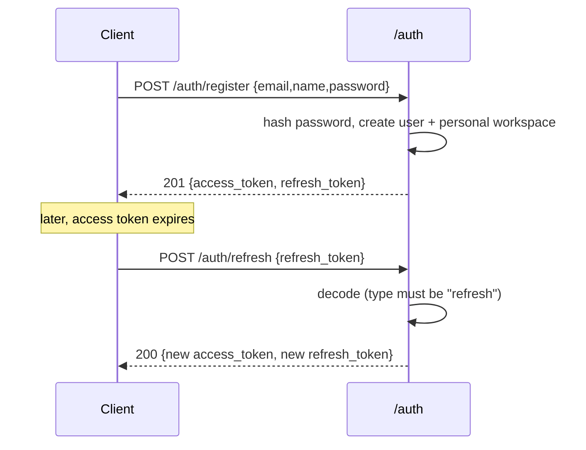
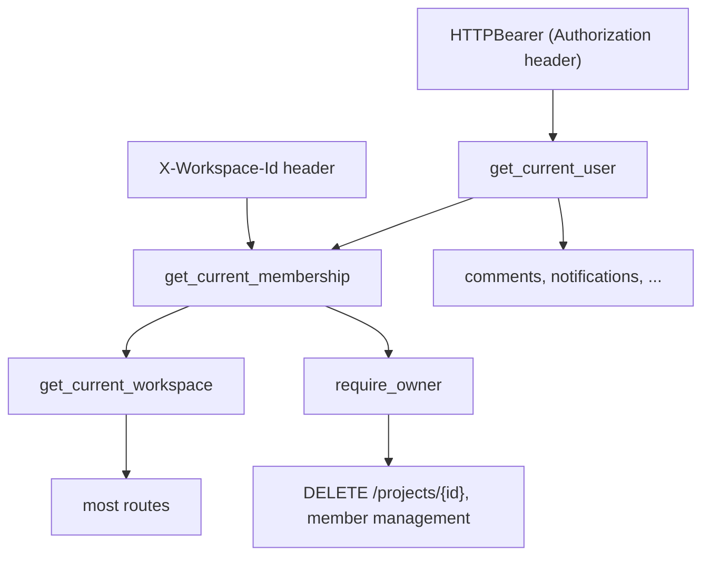
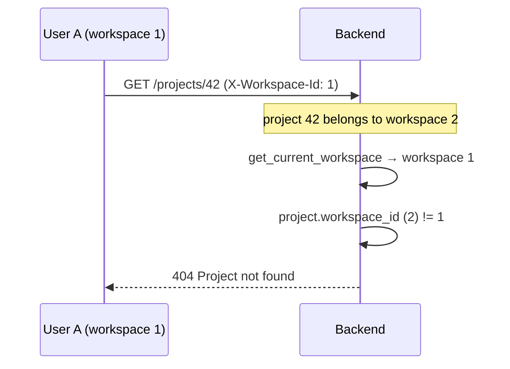
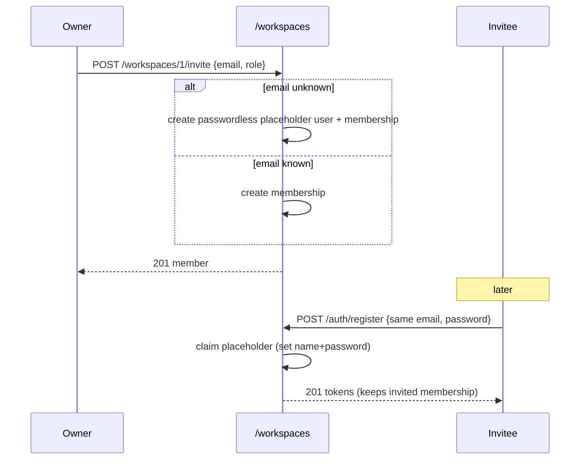
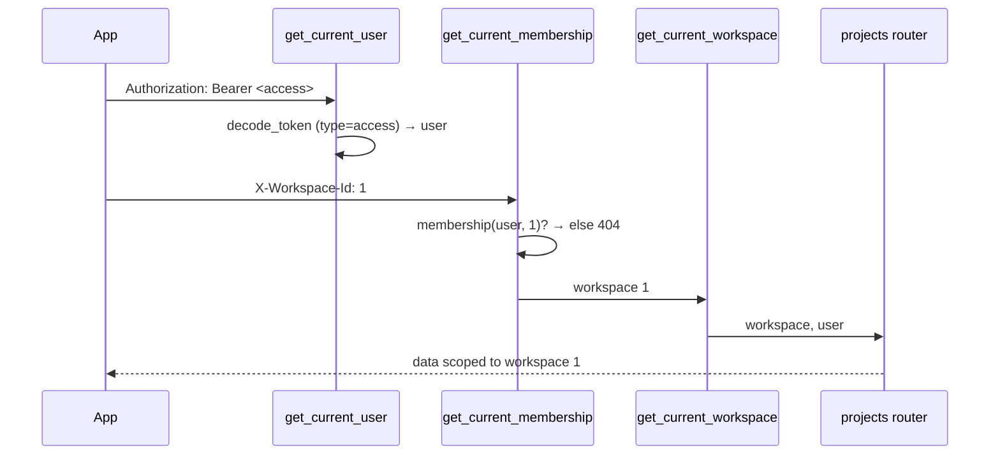

# 7. Authentication & Multi-Tenancy

This is the most important backend chapter. It explains how Korvexa knows *who*
you are and *which workspace* you're acting in, and how that single mechanism —
the **workspace seam** — lets the same code serve one user or a whole team.

Files covered:
[`core/security.py`](../backend/app/core/security.py),
[`deps.py`](../backend/app/deps.py),
[`routers/auth.py`](../backend/app/routers/auth.py),
[`routers/workspaces.py`](../backend/app/routers/workspaces.py),
[`services/workspaces.py`](../backend/app/services/workspaces.py),
[`schemas/auth.py`](../backend/app/schemas/auth.py),
[`schemas/workspace.py`](../backend/app/schemas/workspace.py).

## Tokens & passwords — `security.py`

[`core/security.py`](../backend/app/core/security.py) is the crypto layer. It
does two jobs: hash/verify passwords, and mint/verify JWTs.

### Passwords (bcrypt)

```python
def hash_password(password: str) -> str:
    salt = bcrypt.gensalt(rounds=settings.bcrypt_rounds)
    return bcrypt.hashpw(password.encode("utf-8")[:72], salt).decode("utf-8")

def verify_password(password: str, password_hash: str) -> bool:
    try:
        return bcrypt.checkpw(password.encode("utf-8")[:72], password_hash.encode("utf-8"))
    except ValueError:
        return False
```

- The work factor is configurable via `BCRYPT_ROUNDS` (default 12; tests lower it
  so the suite isn't dominated by hashing).
- Passwords are truncated to bcrypt's 72-byte limit explicitly so long inputs
  hash and verify consistently instead of raising.
- **Why bcrypt directly and not `passlib[bcrypt]`?** `passlib` 1.7.x probes the
  bcrypt library with a >72-byte password on import, which modern `bcrypt`
  (≥4.1) rejects — breaking the shim. Using `bcrypt` directly is the same
  algorithm without the broken wrapper. (See the module docstring.)

### JWTs (access + refresh)

Two token *types* are issued, both HS256-signed with `SECRET_KEY`:

```python
ACCESS_TOKEN_TYPE = "access"     # short-lived (default 30 min)
REFRESH_TOKEN_TYPE = "refresh"   # long-lived (default 30 days)

def _create_token(subject, token_type, expires_delta):
    payload = {"sub": subject, "type": token_type, "iat": now, "exp": now + expires_delta}
    return jwt.encode(payload, settings.secret_key, algorithm="HS256")
```

`decode_token(token, expected_type=...)` returns the user id or `None`. It
returns `None` — never raises — for an invalid signature, an expired token
(`exp`), a wrong `type`, or a non-integer `sub`. The `type` check is what stops a
**refresh token from being used as an access token** (and vice versa).

## The auth router — `routers/auth.py`

[`routers/auth.py`](../backend/app/routers/auth.py) exposes four endpoints. The
full request/response shapes are in the [API Reference](14-api-reference.md#auth).

| Endpoint | What it does |
|----------|--------------|
| `POST /auth/register` | Create an account, create a personal workspace, return tokens |
| `POST /auth/login` | Verify credentials, return tokens |
| `POST /auth/refresh` | Exchange a valid refresh token for a new token pair |
| `GET /auth/me` | Return the current user |

### Registration (and claiming invites)

```python
existing = session.exec(select(User).where(User.email == payload.email)).first()

if existing is not None and existing.password_hash is not None:
    raise HTTPException(409, "Email already registered")

if existing is not None:                 # a passwordless invite placeholder
    existing.name = payload.name
    existing.password_hash = hash_password(payload.password)
    user = existing                       # "claim" it
else:
    user = User(email=..., name=..., password_hash=hash_password(payload.password))

if not user_has_workspace(session, user.id):
    create_workspace(session, name=f"{payload.name}'s Workspace", owner=user, commit=False)
```

Three cases in one handler:

1. **New email** → create the user + a personal workspace (they become its
   owner).
2. **Email exists with a password** → `409 Conflict`.
3. **Email exists without a password** → it's an *invite placeholder*; set the
   name and password to "claim" it. Because they already belong to the inviting
   workspace, no redundant personal workspace is created.

Both `register` and `login` are decorated with `@limiter.limit(...)` (see
[rate limiting](05-backend-foundation.md#rate-limiting--rate_limitpy)).

### Login

```python
user = session.exec(select(User).where(User.email == payload.email)).first()
if user is None or user.password_hash is None or not verify_password(payload.password, user.password_hash):
    raise HTTPException(401, "Invalid email or password")
return _token_pair(user.id)
```

The error message is deliberately identical whether the email is unknown or the
password is wrong — it doesn't leak which emails exist.

### Refresh

```python
user_id = decode_token(payload.refresh_token, expected_type=REFRESH_TOKEN_TYPE)
if user_id is None or session.get(User, user_id) is None:
    raise HTTPException(401, "Invalid or expired refresh token")
return _token_pair(user_id)
```



## The seam — `deps.py`

[`deps.py`](../backend/app/deps.py) contains the dependencies every protected
route uses. This is the file Phase 3 rewrote to turn a single-user app into a
multi-tenant one — **without touching any router**.

### `get_current_user` — who are you?

```python
_bearer = HTTPBearer(auto_error=False)   # we raise our own 401

def get_current_user(credentials=Depends(_bearer), session=Depends(get_session)) -> User:
    if credentials is None or not credentials.credentials:
        raise HTTPException(401, "Not authenticated")
    user_id = decode_token(credentials.credentials, expected_type=ACCESS_TOKEN_TYPE)
    if user_id is None:
        raise HTTPException(401, "Invalid or expired token")
    user = session.get(User, user_id)
    if user is None:
        raise HTTPException(401, "Invalid or expired token")
    return user
```

`auto_error=False` lets Korvexa return its own consistent `401` (via the error
envelope) instead of FastAPI's default.

### `get_current_membership` — which workspace, and are you in it?

```python
def get_current_membership(user=Depends(get_current_user), session=..., x_workspace_id: Optional[int] = Header(default=None)) -> Membership:
    if x_workspace_id is not None:
        membership = session.exec(select(Membership).where(
            Membership.user_id == user.id, Membership.workspace_id == x_workspace_id)).first()
        if membership is None:
            raise HTTPException(404, "Workspace not found")   # can't even tell it exists
        return membership
    # No header → default to the user's first workspace
    membership = session.exec(select(Membership).where(
        Membership.user_id == user.id).order_by(Membership.workspace_id)).first()
    if membership is None:
        raise HTTPException(404, "No workspace available")
    return membership
```

This is where tenancy is enforced. Note the deliberate **`404`, not `403`**, when
you request a workspace you're not a member of — you can't distinguish "doesn't
exist" from "not yours". If no header is sent, it falls back to your first
workspace so single-workspace clients don't need to send one.

### `get_current_workspace` and `require_owner`

```python
def get_current_workspace(membership=Depends(get_current_membership), session=...) -> Workspace:
    return session.get(Workspace, membership.workspace_id)

def require_owner(membership=Depends(get_current_membership)) -> Membership:
    if membership.role != MembershipRole.owner.value:
        raise HTTPException(403, "Requires workspace owner role")
    return membership
```

Routers depend on these by return type:

- `workspace: Workspace = Depends(get_current_workspace)` — the active tenant.
- `user: User = Depends(get_current_user)` — the actor (for authoring comments,
  stamping activity, sending notifications).
- `_owner: Membership = Depends(require_owner)` — guard for owner-only actions
  (used by `DELETE /projects/{id}`).

### The dependency graph



### Why this is "the seam"

In Phase 1–2, `get_current_workspace` simply returned the one seeded workspace.
Phase 3 replaced its body with the token+header+membership logic above. Because
the **return type never changed** (`Workspace`), every handler written in Phase
1–2 kept working unmodified. The proof is in the tests: the Phase 1–2 suites
still pass (through an authenticated test client), and new two-user tests in
[`test_teams.py`](../backend/tests/test_teams.py) prove user A cannot read,
write, or even confirm the existence of user B's workspace.



## Workspaces, members, invites & roles — `routers/workspaces.py`

[`routers/workspaces.py`](../backend/app/routers/workspaces.py) manages
workspaces and their members. Unlike most routers, these endpoints take the
workspace id **in the path** and re-check membership there (helper
`_membership_or_404`) and ownership (`_require_owner`), because you're operating
*on* a workspace, possibly one that isn't your active one.

| Endpoint | Auth | Purpose |
|----------|------|---------|
| `GET /workspaces` | member | List workspaces you belong to (+ your role in each) |
| `POST /workspaces` | any user | Create a new workspace (you become owner) |
| `GET /workspaces/{id}/members` | member | List members |
| `POST /workspaces/{id}/invite` | **owner** | Invite by email with a role |
| `PATCH /workspaces/{id}/members/{user_id}` | **owner** | Change a member's role |
| `DELETE /workspaces/{id}/members/{user_id}` | **owner** | Remove a member |

### Invites

```python
invited = session.exec(select(User).where(User.email == payload.email)).first()
if invited is None:
    invited = User(email=payload.email, name=payload.email.split("@")[0])  # placeholder, no password
    session.add(invited); session.flush()

# reject duplicate membership, then:
membership = Membership(workspace_id=workspace_id, user_id=invited.id, role=payload.role)
```

Inviting a **known** email adds a membership immediately. Inviting an **unknown**
email creates a passwordless *placeholder* user and a membership; when that
person later registers with the same email, `register` claims the placeholder
(see [above](#registration-and-claiming-invites)). This gives a working invite
flow without a separate `invitations` table.



### Role enforcement

Owner-only actions call `_require_owner`. Two guardrails in `remove_member`:

- An owner **cannot remove themselves** (`400`), preventing a workspace from
  losing its owner by accident.
- Roles are validated against `{"owner", "member"}`.

Role enforcement is also applied outside this router: `DELETE /projects/{id}`
depends on `require_owner` (see [Chapter 8](08-projects-tasks-board.md)).

## Workspace creation helper — `services/workspaces.py`

[`services/workspaces.py`](../backend/app/services/workspaces.py) factors out the
"create a workspace + make the creator its owner" logic used by both
registration and `POST /workspaces`:

```python
def create_workspace(session, *, name, owner, commit=True) -> Workspace:
    workspace = Workspace(name=name, owner_id=owner.id)
    session.add(workspace); session.flush()
    session.add(Membership(workspace_id=workspace.id, user_id=owner.id, role=MembershipRole.owner.value))
    if commit: session.commit(); session.refresh(workspace)
    return workspace

def user_has_workspace(session, user_id) -> bool: ...
```

The `commit=False` option lets `register` create the user and workspace in one
transaction.

## Putting it together: a full authenticated request



---

Previous: [Chapter 6 — Data Model & Migrations](06-data-model-and-migrations.md) ·
Next: [Chapter 8 — Projects, Tasks & the Board](08-projects-tasks-board.md)
