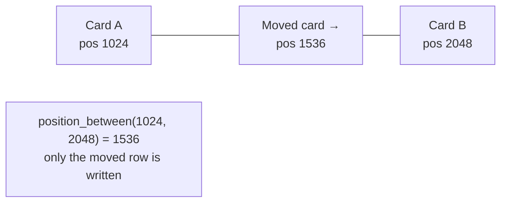

# 8. Projects, Tasks & the Board

This chapter covers Korvexa's core domain: projects, tasks, the Kanban board,
reordering, filtering, and the cross-project "My Tasks" view.

Files covered:
[`routers/projects.py`](../backend/app/routers/projects.py),
[`routers/tasks.py`](../backend/app/routers/tasks.py),
[`routers/me.py`](../backend/app/routers/me.py),
[`services/serialization.py`](../backend/app/services/serialization.py),
[`utils/keygen.py`](../backend/app/utils/keygen.py),
[`utils/position.py`](../backend/app/utils/position.py),
and schemas [`project.py`](../backend/app/schemas/project.py),
[`task.py`](../backend/app/schemas/task.py),
[`pagination.py`](../backend/app/schemas/pagination.py).

## Projects — `routers/projects.py`

A project belongs to a workspace and has a short **key**, open/total task
counts, a color, and an archived flag.

| Endpoint | Auth | Purpose |
|----------|------|---------|
| `GET /projects` | member | List projects (`?include_archived=`) |
| `POST /projects` | member | Create (key auto-derived if omitted) |
| `GET /projects/{id}` | member | One project + counts |
| `PATCH /projects/{id}` | member | Update name/description/color |
| `POST /projects/{id}/archive` | member | Hide from default list |
| `POST /projects/{id}/unarchive` | member | Restore |
| `DELETE /projects/{id}` | **owner** | Delete (cascades to tasks) |

### The tenancy guard: `get_project_or_404`

Every project route funnels through one helper that enforces isolation:

```python
def get_project_or_404(session, workspace, project_id) -> Project:
    project = session.get(Project, project_id)
    if project is None or project.workspace_id != workspace.id:
        raise HTTPException(404, "Project not found")   # same 404 for "missing" and "not yours"
    return project
```

This is the pattern repeated across the whole backend: fetch by id, then check
`row.workspace_id == workspace.id`, and return an indistinguishable `404` if not.
It's why cross-workspace access is impossible even if you know an id.

### Creating a project & the key

```python
existing_keys = set(session.exec(select(Project.key).where(Project.workspace_id == workspace.id)).all())
if payload.key:
    key = payload.key.strip().upper()
    if key in existing_keys:
        raise HTTPException(409, f"Project key '{key}' already exists")
else:
    key = unique_project_key(derive_project_key(payload.name), existing_keys)
```

If you supply a key, it's uppercased and checked for collisions (`409`). If you
don't, it's derived from the name and de-duplicated. That derivation is
[`utils/keygen.py`](../backend/app/utils/keygen.py):

```python
derive_project_key("Marketing")            # "MARK"  (single word → first 4 letters)
derive_project_key("Marketing Site Revamp")# "MSR"   (multi-word → initials, up to 5)
derive_project_key("!!!")                  # "PROJ"  (fallback)

unique_project_key("ACME", {"ACME"})       # "ACME2" (numeric suffix on collision)
```

### Task counts

`GET /projects` and `GET /projects/{id}` return `open_tasks` and `total_tasks`,
computed with `COUNT` queries (open = status not `done`). The response schema is
`ProjectRead` ([`schemas/project.py`](../backend/app/schemas/project.py)), which
adds these two computed fields on top of the stored columns.

### Archive vs delete

- **Archive** flips `archived = True`. `GET /projects` hides archived projects
  unless `include_archived=true`; the project and its tasks stay intact and it's
  still reachable directly by id.
- **Delete** removes the project and cascades to its tasks — and is **owner-only**
  via `_owner: Membership = Depends(require_owner)`.

## Tasks — `routers/tasks.py`

This is the largest router. It owns task CRUD, the board, reorder, and label
assignment. All routes resolve the task through `get_task_or_404`, which also
verifies the task's project is in the current workspace.

| Endpoint | Purpose |
|----------|---------|
| `GET /projects/{id}/tasks` | Paginated, filterable task list |
| `GET /projects/{id}/board` | Tasks grouped by status column |
| `POST /projects/{id}/tasks` | Create a task |
| `GET /tasks/{id}` | One task (with labels) |
| `PATCH /tasks/{id}` | Update fields / move columns |
| `POST /tasks/{id}/reorder` | Reorder within a column |
| `PUT /tasks/{id}/labels` | Replace a task's label set |
| `DELETE /tasks/{id}` | Delete a task |

### Task numbers and human keys

On create, the parent's counter is bumped and used as the task `number`:

```python
project.task_counter += 1
number = project.task_counter          # stable even after deletions
task = Task(project_id=project.id, number=number, ..., position=next_position(max_position))
```

The response's `key` is assembled in serialization as `f"{project.key}-{task.number}"`
(e.g. `ACME-42`). Numbers are unique per project (`uq_task_project_number`), so
two projects each start at 1.

### Serialization & the N+1 avoidance

Task responses include their labels. Rather than query labels per task,
[`services/serialization.py`](../backend/app/services/serialization.py) batches:

```python
def labels_for_tasks(session, task_ids):   # one query for all tasks' labels
    rows = session.exec(select(TaskLabel.task_id, Label).join(Label, ...)
                        .where(TaskLabel.task_id.in_(task_ids)).order_by(Label.name)).all()
    # → {task_id: [LabelRead, ...]}

def tasks_to_reads(session, tasks, project):
    label_map = labels_for_tasks(session, [t.id for t in tasks])
    return [task_to_read(t, project, label_map.get(t.id, [])) for t in tasks]
```

`task_to_read` is where `key` is built and the ORM row becomes a `TaskRead`.
`task_with_project_to_read` extends it with `project_name`/`project_key` for the
cross-project "My Tasks" view.

### Creating a task — the full sequence

```python
project = get_project_or_404(session, workspace, project_id)
_validate_assignee(session, workspace, payload.assignee_id)   # assignee must be a member
project.task_counter += 1
task = Task(..., position=next_position(max_position_in_target_column))
session.add(project); session.add(task); session.flush()      # get task.id
if payload.label_ids:
    set_task_labels(session, workspace, task.id, payload.label_ids)
record_activity(session, task_id=task.id, action="created", actor_id=user.id)
if payload.assignee_id is not None:
    notify_assignment(session, ...)                            # in-app notification
session.commit()
```

Note the ordering: everything is added to the session and committed **once**, so
the task, its labels, its activity entry, and any notification land atomically.
Activity and notifications are covered in
[Chapter 9](09-comments-labels-activity.md) and
[Chapter 10](10-assignments-notifications.md).

### Moving columns vs. reordering

There are two distinct operations, and understanding the difference matters:

**Moving to another column** — `PATCH /tasks/{id}` with a new `status`. If no
explicit `position` is given, the task is **appended to the end** of the target
column:

```python
if new_status != task.status:
    record_activity(..., action="status_changed", old_value=task.status, new_value=new_status)
    if "position" not in data:
        max_position = session.exec(select(func.max(Task.position)).where(
            Task.project_id == task.project_id, Task.status == new_status)).one()
        task.position = next_position(max_position)
    task.status = new_status
```

**Reordering within a column** — `POST /tasks/{id}/reorder`. This is where the
fractional rank pays off (below).

`PATCH` also records activity for tracked field edits (`title`, `description`,
`priority`, `assignee_id`, `due_date`) and fires an assignment notification when
`assignee_id` changes to a real member.

### Reordering: fractional ranks

The `position` column is a float. To place a card between two others, you take
the midpoint of their positions — writing **only the moved card's row**, never
renumbering the column. [`utils/position.py`](../backend/app/utils/position.py):

```python
POSITION_GAP = 1024.0
def next_position(max_position):                 # append to end
    return (max_position or 0.0) + POSITION_GAP
def position_between(before, after):             # insert between neighbors
    if before is None and after is None: return POSITION_GAP
    if before is None:  return after / 2         # insert at the very start
    if after is None:   return before + POSITION_GAP   # at the very end
    return (before + after) / 2                  # midpoint
```

The reorder endpoint accepts either an explicit `position`, or `before_id` /
`after_id` neighbors:

```python
# before_id = the task the card should sit immediately BEFORE (its new successor)
# after_id  = the task it should sit immediately AFTER  (its new predecessor)
predecessor = _sibling_position(session, task, payload.after_id, workspace)
successor   = _sibling_position(session, task, payload.before_id, workspace)
task.position = position_between(predecessor, successor)
```



A sibling in a *different* project is rejected with `400`. Reorder stability is
proven by [`tests/test_reorder.py`](../backend/tests/test_reorder.py) (it checks
the untouched cards keep their exact positions).

### The board

`GET /projects/{id}/board` returns a dict keyed by status, each value a list of
`TaskRead` ordered by `position`:

```json
{ "todo": [ ... ], "in_progress": [ ... ], "done": [ ... ] }
```

It accepts the same filters as the list endpoint except `status` (the board
*is* grouped by status). Filtering is shared through `_apply_task_filters`.

### Filtering & search

Both `list_tasks` and `get_board` run inputs through `_apply_task_filters`:

```python
if q:          # case-insensitive LIKE on title OR description
    query = query.where(or_(Task.title.ilike(f"%{q}%"), Task.description.ilike(f"%{q}%")))
if status:     query = query.where(Task.status == status.value)
if priority:   query = query.where(Task.priority == priority)
if label_id:   query = query.where(Task.id.in_(select(TaskLabel.task_id).where(TaskLabel.label_id == label_id)))
if due == "overdue": ... due_date < today
if due == "today":   ... due_date <= today
if due == "week":    ... due_date <= today + 7 days
```

### Pagination

List endpoints return a `Page` envelope
([`schemas/pagination.py`](../backend/app/schemas/pagination.py)):

```python
class Page(BaseModel, Generic[T]):
    items: list[T]
    total: int
    limit: int
    offset: int
```

`limit` is clamped to `1..200` and `offset` to `>= 0`, so absurd inputs are
corrected rather than erroring (verified in
[`tests/test_hardening.py`](../backend/tests/test_hardening.py)).

## "My Tasks" / upcoming — `routers/me.py`

[`routers/me.py`](../backend/app/routers/me.py) provides one cross-project view:

```
GET /me/upcoming?window=today|week|all&mine=true|false
```

It returns open tasks (never `done`) across **all** projects in the workspace,
each carrying its `project_name`/`project_key`:

- **Always includes overdue** tasks, regardless of window.
- `today` → additionally requires a due date on/before today.
- `week` → due date within 7 days.
- `all` → every open task, due date or not.
- `mine=true` → only tasks assigned to the current user (the "My Tasks" view).
- Sorted by **due date, then priority** (high → low).

```python
query = select(Task, Project).join(Project, ...).where(
    Project.workspace_id == workspace.id, Task.status != TaskStatus.done.value)
if mine:
    query = query.where(Task.assignee_id == user.id)
# ... window filter, then sort by (due_date or date.max, priority_rank)
```

`mine` defaults to `false`, which keeps the endpoint backward-compatible with the
Phase 1/2 behavior (all open tasks); the Flutter "My Tasks" screen sets
`mine=true` by default.

## Schemas: request vs response

The task schemas ([`schemas/task.py`](../backend/app/schemas/task.py)) separate
input from output:

- `TaskCreate` — title (required), description, status, priority, assignee_id,
  due_date, `label_ids`.
- `TaskUpdate` — all-optional PATCH fields (only provided keys are applied).
- `TaskReorder` — `position` or `before_id`/`after_id`.
- `TaskRead` — the full task plus `key` and `labels`.
- `TaskWithProjectRead` — `TaskRead` plus `project_name`/`project_key`.

Because `status`/`priority` are typed as the enums in the schemas, an invalid
value is rejected with `422` at the edge, even though the DB stores them as
strings.

---

Previous: [Chapter 7 — Authentication & Multi-Tenancy](07-auth-and-multitenancy.md) ·
Next: [Chapter 9 — Comments, Labels & Activity](09-comments-labels-activity.md)
