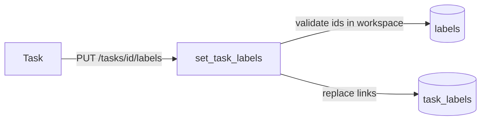
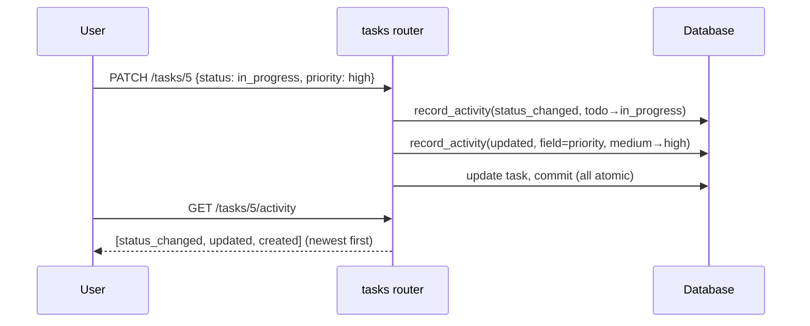

# 9. Comments, Labels & Activity

These three features add collaboration and history to tasks. They were built in
Phase 2 and share a common trait: each is a thin router plus (where needed) a
small service, all funneling through the same workspace-isolation guards.

Files covered:
[`routers/comments.py`](../backend/app/routers/comments.py),
[`routers/labels.py`](../backend/app/routers/labels.py),
[`routers/activity.py`](../backend/app/routers/activity.py),
[`services/activity.py`](../backend/app/services/activity.py),
[`services/task_labels.py`](../backend/app/services/task_labels.py),
and the matching schemas.

## Comments — `routers/comments.py`

| Endpoint | Auth | Purpose |
|----------|------|---------|
| `GET /tasks/{id}/comments` | member | Paginated comment list (with author name) |
| `POST /tasks/{id}/comments` | member | Add a comment (fires @mention notifications) |
| `PATCH /comments/{id}` | **author** | Edit your own comment |
| `DELETE /comments/{id}` | **author** | Delete your own comment |

### Author identity and isolation

The acting user comes from `get_current_user` (the same seam used everywhere).
Comments are authored as that user, and edits/deletes are **author-only**:

```python
if comment.author_id != user.id:
    raise HTTPException(403, "You can only edit your own comments")
```

Reads join the author so the response includes `author_name` — the list uses a
single joined query and is paginated with the same `Page` envelope as tasks:

```python
rows = session.exec(select(Comment, User.name).join(User, Comment.author_id == User.id)
                    .where(Comment.task_id == task_id).order_by(Comment.created_at)
                    .limit(limit).offset(offset)).all()
```

Every comment route first calls `_get_task_or_404`, which verifies the comment's
task belongs to the current workspace — so you can't read or write comments on
another tenant's task (proved in
[`tests/test_phase2_isolation.py`](../backend/tests/test_phase2_isolation.py)).

### Mentions on create

When a comment is created, it's flushed to get an id, then
`notify_mentions(...)` scans the body for `@handles` and creates notifications
for matching workspace members before the single commit:

```python
comment = Comment(task_id=task_id, author_id=user.id, body=payload.body)
session.add(comment); session.flush()          # need comment.id
notify_mentions(session, workspace_id=workspace.id, task_id=task_id,
                comment_id=comment.id, body=payload.body, actor=user)
session.commit()
```

The mention mechanics live in [Chapter 10](10-assignments-notifications.md#mentions).

## Labels — `routers/labels.py`

Labels are **workspace-scoped**: they belong to a workspace and can be attached
to any task in it.

| Endpoint | Auth | Purpose |
|----------|------|---------|
| `GET /labels` | member | List the workspace's labels |
| `POST /labels` | member | Create a label (unique name per workspace) |
| `PATCH /labels/{id}` | member | Rename / recolor |
| `DELETE /labels/{id}` | member | Delete (removes it from all tasks via cascade) |

Names are unique within a workspace (`uq_label_workspace_name`); creating a
duplicate returns `409`. Deleting a label cascades through `task_labels`, so it
simply disappears from any task it was on.

### Attaching labels to tasks

Label assignment lives on the **tasks** router (`PUT /tasks/{id}/labels`) but the
logic is in [`services/task_labels.py`](../backend/app/services/task_labels.py).
It **replaces** the whole set and validates tenancy:

```python
def set_task_labels(session, workspace, task_id, label_ids):
    unique_ids = list(dict.fromkeys(label_ids))          # de-dupe, keep order
    if unique_ids:
        found = session.exec(select(Label.id).where(
            Label.id.in_(unique_ids), Label.workspace_id == workspace.id)).all()
        missing = set(unique_ids) - set(found)
        if missing:
            raise HTTPException(400, f"Unknown label id(s) for this workspace: {sorted(missing)}")
    # clear existing links, then add the requested ones
    for link in session.exec(select(TaskLabel).where(TaskLabel.task_id == task_id)).all():
        session.delete(link)
    for label_id in unique_ids:
        session.add(TaskLabel(task_id=task_id, label_id=label_id))
```

The key safety property: **a label from another workspace can't be attached to
your task** — passing a foreign label id returns `400`. This closes a subtle
cross-tenant leak and is tested in
[`test_phase2_isolation.py`](../backend/tests/test_phase2_isolation.py).

Labels can also be set at task-create time via `TaskCreate.label_ids`, and used
to **filter the board** via `?label_id=` (see
[Chapter 8](08-projects-tasks-board.md#filtering--search)).



## Activity log — `routers/activity.py`

Every task has an append-only history. The log is **written by mutations** (in
the tasks router) and **read** through one endpoint:

```
GET /tasks/{id}/activity   →  list of entries, newest first
```

### Writing entries — `services/activity.py`

`record_activity(...)` builds an `ActivityLog` row and adds it to the session
**without committing** — so the entry commits atomically with the change that
caused it (no orphan entries for rolled-back changes):

```python
def record_activity(session, *, task_id, action, field=None, old_value=None, new_value=None, actor_id=None):
    entry = ActivityLog(task_id=task_id, actor_id=actor_id, action=action, field=field,
                        old_value=None if old_value is None else str(old_value),
                        new_value=None if new_value is None else str(new_value))
    session.add(entry)
    return entry
```

Values are stringified for a uniform schema. The tasks router records:

| Action | When | Fields captured |
|--------|------|-----------------|
| `created` | task created | — |
| `status_changed` | status changes | `field=status`, old → new |
| `updated` | a tracked field changes | `field`, old → new |

Tracked fields are `title`, `description`, `priority`, `assignee_id`,
`due_date`. A no-op PATCH (same value) records nothing, and **reordering does
not log** — verified in
[`tests/test_activity.py`](../backend/tests/test_activity.py).



### Reading — `routers/activity.py`

```python
get_task_or_404(session, workspace, task_id)      # tenancy check (imported from tasks router)
return session.exec(select(ActivityLog).where(ActivityLog.task_id == task_id)
                    .order_by(ActivityLog.created_at.desc(), ActivityLog.id.desc())).all()
```

Ordering by `created_at` then `id` descending guarantees a stable newest-first
order even when several entries share a timestamp (as they do within one PATCH).

---

Previous: [Chapter 8 — Projects, Tasks & the Board](08-projects-tasks-board.md) ·
Next: [Chapter 10 — Assignments & Notifications](10-assignments-notifications.md)
