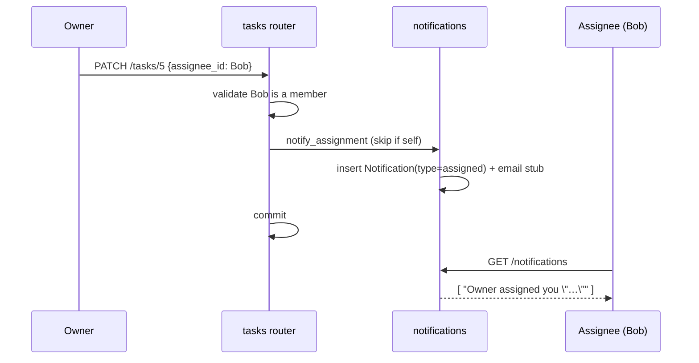

# 10. Assignments & Notifications

This chapter covers the two events that generate **in-app notifications** —
assigning a task and `@mentioning` someone in a comment — plus the notifications
API and the email stub.

Files covered:
[`services/notifications.py`](../backend/app/services/notifications.py),
[`services/email.py`](../backend/app/services/email.py),
[`routers/notifications.py`](../backend/app/routers/notifications.py),
[`models/notification.py`](../backend/app/models/notification.py), and the
assignment path in [`routers/tasks.py`](../backend/app/routers/tasks.py).

## Assignees

A task's `assignee_id` points at a user. Assignment happens through the normal
task create/update endpoints, with one rule enforced by `_validate_assignee`:

```python
def _validate_assignee(session, workspace, assignee_id):
    if assignee_id is None:
        return
    membership = session.exec(select(Membership).where(
        Membership.workspace_id == workspace.id, Membership.user_id == assignee_id)).first()
    if membership is None:
        raise HTTPException(400, "Assignee is not a member of this workspace")
```

You can only assign a task to a **member of its workspace** — assigning a
non-member (or a random id) is a `400`. This keeps assignments inside the tenant
boundary. "My Tasks" (`GET /me/upcoming?mine=true`, see
[Chapter 8](08-projects-tasks-board.md)) filters to `assignee_id == current user`.

## The notification model

[`models/notification.py`](../backend/app/models/notification.py) is a single
table serving both notification kinds:

```python
class Notification(SQLModel, table=True):
    user_id: int            # recipient
    workspace_id: int       # notifications are per-workspace
    type: str               # "assigned" | "mention"
    task_id: Optional[int]  # deep-link target
    comment_id: Optional[int]
    actor_id: Optional[int] # who caused it
    message: str            # pre-rendered human text
    read: bool = False
    created_at: datetime
```

`message` is rendered at creation time, so the client just displays it. `read`
drives the unread badge. `workspace_id` scopes them, so switching workspaces
shows a different notification set.

## Creating notifications — `services/notifications.py`

Like activity entries, notifications are **added to the session but not
committed** by the service, so they land atomically with the triggering mutation.

### Assignment notifications

```python
def notify_assignment(session, *, workspace_id, task_id, task_title, assignee_id, actor):
    if assignee_id == actor.id:
        return None                     # no self-notification
    notification = Notification(user_id=assignee_id, workspace_id=workspace_id,
        type="assigned", task_id=task_id, actor_id=actor.id,
        message=f'{actor.name} assigned you "{task_title}"')
    session.add(notification)
    assignee = session.get(User, assignee_id)
    if assignee is not None:
        send_email(assignee.email, "You were assigned a task", notification.message)
    return notification
```

It's called from the tasks router in two places:

- **On create**, if `assignee_id` is set.
- **On update**, if `assignee_id` *changes* to a non-null member:

```python
if field == "assignee_id" and value is not None:
    assignee_changed_to = value
...
if assignee_changed_to is not None:
    notify_assignment(session, workspace_id=..., task_id=..., task_title=..., assignee_id=..., actor=user)
```

Assigning a task to **yourself** creates no notification (tested in
[`test_assignees_notifications.py`](../backend/tests/test_assignees_notifications.py)).



### Mentions

`notify_mentions` parses `@handles` out of a comment body and notifies matching
members:

```python
_MENTION_RE = re.compile(r"@([\w.\-]+)")            # @jane.doe, @bob, @first-last

def notify_mentions(session, *, workspace_id, task_id, comment_id, body, actor):
    handles = {h.lower() for h in _MENTION_RE.findall(body)}
    if not handles: return []
    members = session.exec(select(User).join(Membership, ...)
                           .where(Membership.workspace_id == workspace_id)).all()
    for member in members:
        if member.id == actor.id: continue
        local = member.email.split("@")[0].lower()       # "bob" from bob@x.com
        name_handle = member.name.replace(" ", "").lower()  # "bobsmith" from "Bob Smith"
        if local in handles or name_handle in handles:
            session.add(Notification(type="mention", user_id=member.id, ...))
            send_email(member.email, "You were mentioned", ...)
```

Matching rules:

- A handle matches a member if it equals the **local part of their email**
  (before the `@`) or their **name with spaces removed**, case-insensitively.
- Only **members of the comment's workspace** are considered — you cannot
  mention someone into another tenant (no cross-tenant leak).
- You never notify yourself.

> **Caveat / assumption:** matching is by email-local-part or squashed name, not
> a curated username. Two members whose handles collide (e.g. `bob@a.com` and
> `bob@b.com` in the same workspace) would both match `@bob`. This is a
> deliberate simplicity trade-off in the current code.

## Notifications API — `routers/notifications.py`

All endpoints are scoped to the current user **and** the active workspace.

| Endpoint | Purpose |
|----------|---------|
| `GET /notifications?unread_only=` | List your notifications (newest first) |
| `GET /notifications/unread_count` | `{ "unread": n }` for the badge |
| `POST /notifications/{id}/read` | Mark one read (must be yours → else 404) |
| `POST /notifications/read_all` | Mark all in this workspace read; returns count |

```python
# list
query = select(Notification).where(Notification.user_id == user.id,
                                    Notification.workspace_id == workspace.id)
if unread_only:
    query = query.where(Notification.read == False)
return session.exec(query.order_by(Notification.created_at.desc(), Notification.id.desc())).all()

# mark read — ownership check
if notification is None or notification.user_id != user.id:
    raise HTTPException(404, "Notification not found")
```

Trying to mark **someone else's** notification read returns `404` (you can't tell
it exists) — tested in `test_assignees_notifications.py`.

## Email stub — `services/email.py`

Email is intentionally a **stub** — in-app notifications are the real channel:

```python
logger = logging.getLogger("korvexa.email")
def send_email(to, subject, body):
    logger.info("stub email -> %s | %s | %s", to, subject, body)
```

Swapping this for a real provider (SES / SendGrid / SMTP) is a **one-file
change** — the call sites in `notifications.py` don't change. See
[Chapter 18](18-security.md) for notes on treating email content as untrusted
user input if you wire up real delivery.

## Frontend counterpart

On the client, the notification bell shows an unread badge and the
notifications screen lists items and deep-links to the task. That's covered in
[Chapter 13](13-frontend-screens-widgets.md#notificationsscreen).

---

Previous: [Chapter 9 — Comments, Labels & Activity](09-comments-labels-activity.md) ·
Next: [Chapter 11 — Frontend Architecture](11-frontend-architecture.md)
