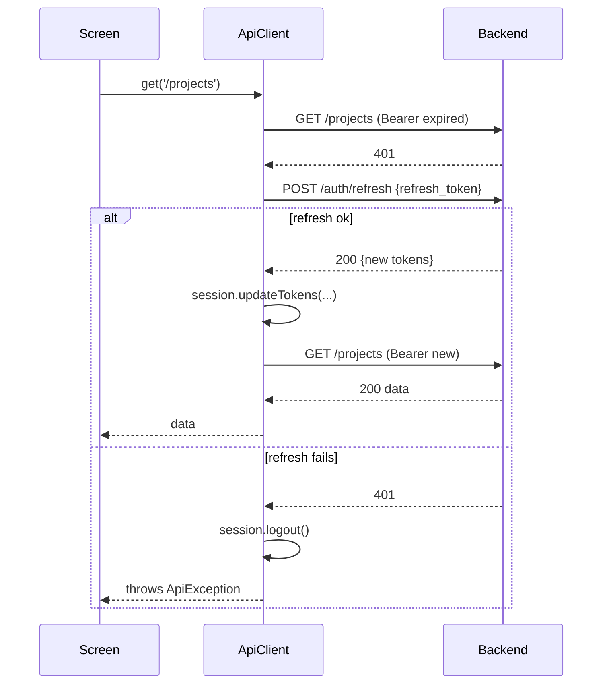
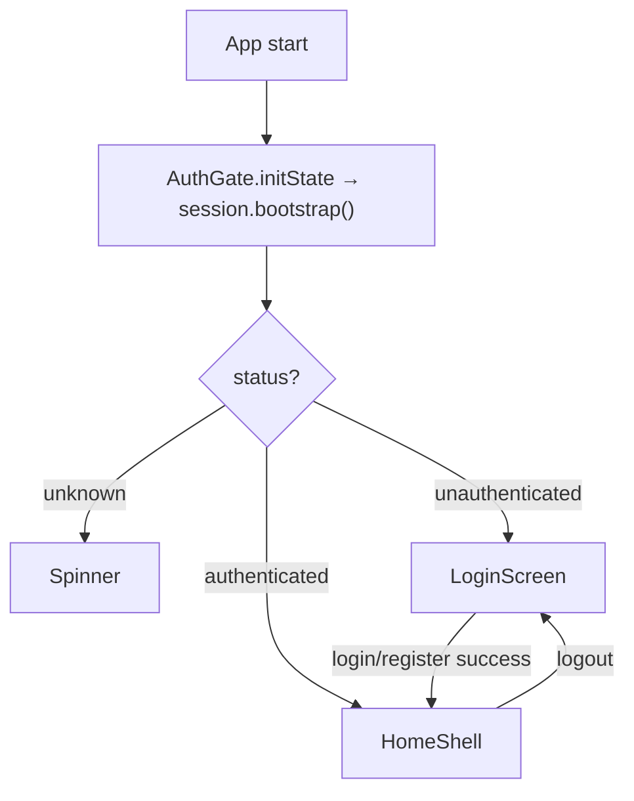

# 11. Frontend Architecture

The Flutter app is a thin, stateful client over the API. This chapter covers its
bootstrap and the "plumbing" every screen depends on: configuration, the session
(tokens + active workspace), the HTTP client with its automatic token refresh,
and secure storage.

Files covered:
[`main.dart`](../frontend/lib/main.dart),
[`config.dart`](../frontend/lib/config.dart),
[`screens/auth_gate.dart`](../frontend/lib/screens/auth_gate.dart),
[`services/session.dart`](../frontend/lib/services/session.dart),
[`services/api_client.dart`](../frontend/lib/services/api_client.dart),
[`services/token_storage.dart`](../frontend/lib/services/token_storage.dart).

## Folder layout

```
frontend/lib/
├── config.dart        # API base URL per platform
├── main.dart          # app entry, provider graph
├── models/            # plain Dart data classes (fromJson)
├── services/          # ApiClient, SessionController, per-resource services
├── providers/         # ChangeNotifier state for screens
├── screens/           # full-page widgets
└── widgets/           # reusable UI pieces
```

The dependency direction is: **screens → providers → services → ApiClient →
backend**, with `SessionController` and `TokenStorage` off to the side holding
auth state. Models are used by every layer.

## Configuration — `config.dart`

[`config.dart`](../frontend/lib/config.dart) chooses the API base URL:

```dart
class AppConfig {
  static const String _override = String.fromEnvironment('API_BASE_URL');
  static String get apiBaseUrl {
    if (_override.isNotEmpty) return _override;      // --dart-define wins
    if (kIsWeb) return 'http://127.0.0.1:8000';       // web/desktop
    try { if (Platform.isAndroid) return 'http://10.0.2.2:8000'; } catch (_) {}
    return 'http://127.0.0.1:8000';
  }
}
```

- A `--dart-define=API_BASE_URL=…` build flag overrides everything.
- The Android emulator can't reach the host's `127.0.0.1`, so it uses the
  emulator alias `10.0.2.2`.
- `Platform` isn't available on web, hence the `try/catch`.

## App bootstrap & the provider graph — `main.dart`

[`main.dart`](../frontend/lib/main.dart) builds the object graph **once** in a
`StatefulWidget`'s `initState`, then exposes it via `provider`:

```dart
class _KorvexaAppState extends State<KorvexaApp> {
  late final SessionController _session;
  late final ApiClient _api;

  @override
  void initState() {
    super.initState();
    _session = SessionController(TokenStorage());
    _api = ApiClient(session: _session, httpClient: widget.httpClient);
    _session.attach(_api);        // break the construction cycle (see below)
  }
  ...
  MultiProvider(providers: [
    ChangeNotifierProvider<SessionController>.value(value: _session),
    Provider<ApiClient>.value(value: _api),
    ChangeNotifierProvider<ProjectsProvider>(create: (c) => ProjectsProvider(ProjectsService(c.read<ApiClient>()))),
    ChangeNotifierProvider<UpcomingProvider>(...),
    ChangeNotifierProvider<LabelsProvider>(...),
    ChangeNotifierProvider<NotificationsProvider>(...),
  ], child: MaterialApp(home: const AuthGate()));
}
```

- `SessionController` and `ApiClient` reference each other (the client reads
  tokens from the session; the session uses the client to fetch `/auth/me` and
  `/workspaces`). The cycle is broken by constructing the session first, then
  the client, then calling `_session.attach(_api)`.
- The app-wide providers (`Projects`, `Upcoming`, `Labels`, `Notifications`) are
  built from the shared `ApiClient`. The per-board provider is created **per
  screen** instead (see [Chapter 13](13-frontend-screens-widgets.md)).
- `httpClient` is injectable so widget tests can pass a mock client and never
  hit the network.

## Session state — `session.dart`

[`SessionController`](../frontend/lib/services/session.dart) is the single source
of truth for auth + tenancy on the client. It's a `ChangeNotifier` the whole app
watches, and it persists tokens/workspace to secure storage.

```dart
enum SessionStatus { unknown, authenticated, unauthenticated }

class SessionController extends ChangeNotifier {
  SessionStatus _status = SessionStatus.unknown;
  String? _accessToken, _refreshToken;
  int? _currentWorkspaceId;
  AppUser? _currentUser;
  List<Workspace> _workspaces = [];
  ...
}
```

Key methods:

| Method | What it does |
|--------|--------------|
| `bootstrap()` | On start: load tokens from storage, validate by fetching `/auth/me` + `/workspaces` |
| `completeLogin(access, refresh)` | After register/login: persist tokens, load user + workspaces |
| `updateTokens(access, refresh)` | Called by `ApiClient` after a transparent refresh |
| `switchWorkspace(id)` | Set + persist the active workspace |
| `refreshWorkspaces()` | Re-fetch the workspace list (after creating one) |
| `logout()` | Clear everything, return to `unauthenticated` |

`bootstrap()` is defensive — if secure storage is unavailable or the token is
invalid, it degrades to a clean logged-out state rather than crashing:

```dart
Future<void> bootstrap() async {
  try {
    _accessToken = await _storage.readAccess();
    _refreshToken = await _storage.readRefresh();
    _currentWorkspaceId = await _storage.readWorkspaceId();
  } catch (_) { _accessToken = null; }          // storage unavailable → logged out
  if (_accessToken == null) { _status = unauthenticated; notifyListeners(); return; }
  try {
    await _loadUserAndWorkspaces();
    _status = authenticated;
  } catch (_) { await _clear(); _status = unauthenticated; }   // bad token → login
  notifyListeners();
}
```

`_ensureValidWorkspace()` guarantees the active workspace id always points at one
the user actually belongs to (defaulting to the first), which keeps the
`X-Workspace-Id` header valid.

## Secure storage — `token_storage.dart`

[`TokenStorage`](../frontend/lib/services/token_storage.dart) wraps
`flutter_secure_storage` for three keys: access token, refresh token, and the
last-selected workspace id.

```dart
Future<void> saveTokens(String access, String refresh) async { ... }
Future<String?> readAccess() => _storage.read(key: _accessKey);
Future<int?> readWorkspaceId() async { ... }
Future<void> clear() async { ... }   // on logout
```

On native platforms this is backed by the OS keychain/keystore; on web by an
encrypted IndexedDB store. See [Chapter 18](18-security.md) for the security
caveats of token storage on web.

## The HTTP client & token refresh — `api_client.dart`

[`ApiClient`](../frontend/lib/services/api_client.dart) is the one place that
talks HTTP. It injects auth headers, decodes JSON, surfaces errors as
`ApiException`, and — crucially — **transparently refreshes the access token on
a 401** and replays the request once.

### Header injection

```dart
Map<String, String> _headers({bool json = false}) {
  final headers = <String, String>{};
  if (json) headers['Content-Type'] = 'application/json';
  final token = session.accessToken;
  if (token != null) headers['Authorization'] = 'Bearer $token';
  final workspaceId = session.currentWorkspaceId;
  if (workspaceId != null) headers['X-Workspace-Id'] = '$workspaceId';
  return headers;
}
```

Every request automatically carries the bearer token and the active workspace —
the two halves of the backend's auth contract (see [Chapter 7](07-auth-and-multitenancy.md)).

### The 401 → refresh → replay loop

```dart
Future<dynamic> _send(Future<http.Response> Function() request) async {
  var response = await request();
  if (response.statusCode == 401 && session.accessToken != null) {
    final refreshed = await _tryRefresh();
    if (refreshed) {
      response = await request();     // replay once with the new token
    } else {
      await session.logout();          // refresh failed → force re-login
    }
  }
  return _decode(response);
}
```

`_tryRefresh()` posts the stored refresh token to `/auth/refresh` (a call that
needs no auth header), and on success calls `session.updateTokens(...)`. This is
why an expired access token is invisible to the user — the client heals itself.



### Error decoding

Non-2xx responses become an `ApiException` carrying the backend's `detail`
message — the same field the [error envelope](05-backend-foundation.md#error-envelope--request-ids--errorspy)
always provides:

```dart
class ApiException implements Exception {
  final int statusCode; final String message;
}
// _decode reads decoded['detail'] for the message, falling back to a generic one.
```

Providers catch `ApiException` and expose `error` strings for screens to show.

## Routing at boot — `auth_gate.dart`

[`AuthGate`](../frontend/lib/screens/auth_gate.dart) kicks off `bootstrap()` and
renders based on session status:

```dart
final status = context.watch<SessionController>().status;
return switch (status) {
  SessionStatus.unknown        => const Scaffold(body: Center(child: CircularProgressIndicator())),
  SessionStatus.unauthenticated => const LoginScreen(),
  SessionStatus.authenticated  => const HomeShell(),
};
```

So the app opens on a spinner while validating stored tokens, then lands on
either the login screen or the home shell.



---

Previous: [Chapter 10 — Assignments & Notifications](10-assignments-notifications.md) ·
Next: [Chapter 12 — Frontend Models, Services & State](12-frontend-models-services-state.md)
