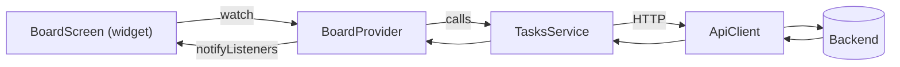

# 12. Frontend Models, Services & State

This chapter documents the client's data layer: the plain-Dart **models** that
mirror API JSON, the **services** that call endpoints, and the **providers**
that hold screen state. The auth-specific pieces (`SessionController`,
`ApiClient`, `TokenStorage`, `AuthService`) are in
[Chapter 11](11-frontend-architecture.md); this chapter covers the rest.

## Models — `lib/models/`

Each model is a plain immutable Dart class with a `fromJson` factory that maps
the backend's snake_case fields. They contain no logic beyond parsing and a few
convenience getters.

| Model | Mirrors | Notable fields / helpers |
|-------|---------|--------------------------|
| [`app_user.dart`](../frontend/lib/models/app_user.dart) | `UserRead` | `id`, `email`, `name` |
| [`workspace.dart`](../frontend/lib/models/workspace.dart) | `WorkspaceRead` + `MemberRead` | `Workspace.isOwner`; `Member` (userId, role, membershipId) |
| [`project.dart`](../frontend/lib/models/project.dart) | `ProjectRead` | `openTasks`, `totalTasks`, `archived` |
| [`task.dart`](../frontend/lib/models/task.dart) | `TaskRead` | `key`, `labels`, `isOverdue`; `TaskStatus`/`TaskPriority` constants |
| [`label.dart`](../frontend/lib/models/label.dart) | `LabelRead` | `id`, `name`, `color` |
| [`comment.dart`](../frontend/lib/models/comment.dart) | `CommentRead` | `authorName`, timestamps |
| [`activity.dart`](../frontend/lib/models/activity.dart) | `ActivityRead` | `describe()` → human sentence |
| [`notification.dart`](../frontend/lib/models/notification.dart) | `NotificationRead` | `AppNotification`: `type`, `taskId`, `read` |

Two examples of the small amount of behavior they carry:

```dart
// task.dart — is this task past due (and not done)?
bool get isOverdue {
  if (dueDate == null || status == TaskStatus.done) return false;
  ... return dueDay.isBefore(todayDay);
}

// activity.dart — render a log entry as a sentence for the timeline
String describe() => switch (action) {
  'created'        => 'created this task',
  'status_changed' => 'changed status from ${oldValue} to ${newValue}',
  'updated'        => 'changed ${field} to "${newValue}"',
  _ => action,
};
```

`task.dart` also re-exports `label.dart` and defines the status/priority
constant sets and their display labels (e.g. `TaskStatus.label('in_progress')`
→ `'In Progress'`), keeping those strings in one place.

## Services — `lib/services/`

Each service wraps one area of the API using the shared `ApiClient`. They turn
JSON into models and back, and contain no UI. This mirrors the backend's router
split almost one-to-one.

| Service | Endpoints it calls | Returns |
|---------|--------------------|---------|
| [`auth_service.dart`](../frontend/lib/services/auth_service.dart) | `/auth/register`, `/auth/login` | `AuthTokens` |
| [`workspaces_service.dart`](../frontend/lib/services/workspaces_service.dart) | `/workspaces*` | `Workspace`, `Member` |
| [`projects_service.dart`](../frontend/lib/services/projects_service.dart) | `/projects*` | `Project` |
| [`tasks_service.dart`](../frontend/lib/services/tasks_service.dart) | `/projects/{id}/tasks`, `/tasks*`, board, reorder, labels | `Task`, board map |
| [`labels_service.dart`](../frontend/lib/services/labels_service.dart) | `/labels*` | `Label` |
| [`comments_service.dart`](../frontend/lib/services/comments_service.dart) | `/tasks/{id}/comments`, `/comments/{id}` | `Comment` |
| [`activity_service.dart`](../frontend/lib/services/activity_service.dart) | `/tasks/{id}/activity` | `Activity` |
| [`me_service.dart`](../frontend/lib/services/me_service.dart) | `/me/upcoming` | `Task` |
| [`notifications_service.dart`](../frontend/lib/services/notifications_service.dart) | `/notifications*` | `AppNotification`, count |

A representative service — note how it just shapes requests and parses
responses:

```dart
class TasksService {
  final ApiClient _client;
  TasksService(this._client);

  Future<Map<String, List<Task>>> board(int projectId, {String? q, String? priority, int? labelId, String? due}) async {
    final query = <String, dynamic>{};
    if (q != null && q.isNotEmpty) query['q'] = q;
    if (priority != null) query['priority'] = priority;
    // ... labelId, due
    final data = await _client.get('/projects/$projectId/board', query: query) as Map<String, dynamic>;
    return data.map((status, tasks) => MapEntry(status,
      (tasks as List).map((e) => Task.fromJson(e)).toList()));
  }

  Future<Task> reorder(int taskId, {int? beforeId, int? afterId, double? position}) async { ... }
  Future<Task> setLabels(int taskId, List<int> labelIds) async { ... }
}
```

`MeService.upcoming(window, {mine})` passes the `mine` flag that powers the "My
Tasks" toggle. `CommentsService.list` unwraps the paginated envelope and returns
just the `items` (the UI shows a single scrollable list).

## State: providers — `lib/providers/`

State is managed with the **provider** package. Each provider is a
`ChangeNotifier` exposing data + `loading`/`error` flags, and methods that call a
service then `notifyListeners()`. Screens `watch` them and rebuild.

| Provider | Scope | Holds |
|----------|-------|-------|
| [`projects_provider.dart`](../frontend/lib/providers/projects_provider.dart) | app-wide | project list, archived toggle, create/delete/archive |
| [`upcoming_provider.dart`](../frontend/lib/providers/upcoming_provider.dart) | app-wide | "My Tasks" list, window + `mineOnly` toggles |
| [`labels_provider.dart`](../frontend/lib/providers/labels_provider.dart) | app-wide | workspace labels, create/delete |
| [`notifications_provider.dart`](../frontend/lib/providers/notifications_provider.dart) | app-wide | notifications + unread count |
| [`board_provider.dart`](../frontend/lib/providers/board_provider.dart) | **per board screen** | one project's columns, filters, move/reorder |

The app-wide four are created in `main.dart`. `BoardProvider` is created fresh by
each `BoardScreen` because it's tied to one project.

### The provider pattern

```dart
class ProjectsProvider extends ChangeNotifier {
  List<Project> _projects = [];
  bool _loading = false;
  String? _error;

  Future<void> load() async {
    _loading = true; _error = null; notifyListeners();
    try {
      _projects = await _service.list(includeArchived: _includeArchived);
    } on ApiException catch (e) {
      _error = e.message;
    } finally {
      _loading = false; notifyListeners();
    }
  }
}
```

Every provider follows this shape: set `loading`, call the service in a
`try/catch (ApiException)`, store data or `error`, always `notifyListeners()`.

### BoardProvider: optimistic-ish mutations

`BoardProvider` holds the three columns and the active filters, and translates UI
gestures into API calls:

```dart
Future<void> moveToColumn(Task task, String newStatus) async {   // drop on a column
  if (task.status == newStatus) return;
  await _mutate(() => _service.update(task.id, {'status': newStatus}));   // PATCH → appends
}

Future<void> reorderBefore(Task task, Task target) async {       // drop on a card
  await _mutate(() async {
    if (task.status != target.status) await _service.update(task.id, {'status': target.status});
    await _service.reorder(task.id, beforeId: target.id);
  });
}

Future<void> _mutate(Future<void> Function() action) async {
  try { await action(); await load(); }
  catch (ApiException e) { _error = e.message; await load(); }   // resync to server truth on failure
}
```

The `_mutate` helper always reloads from the server afterward, so the board never
drifts from backend truth — if a move fails, it re-syncs rather than showing a
stale optimistic state. Filters (`setSearch`, `setPriorityFilter`,
`setLabelFilter`, `setDueFilter`, `clearFilters`) each update state and reload the
board with the new query params.

## How a screen, provider, and service line up



The next chapter walks the actual screens and widgets that consume these
providers.

---

Previous: [Chapter 11 — Frontend Architecture](11-frontend-architecture.md) ·
Next: [Chapter 13 — Frontend Screens & Widgets](13-frontend-screens-widgets.md)
