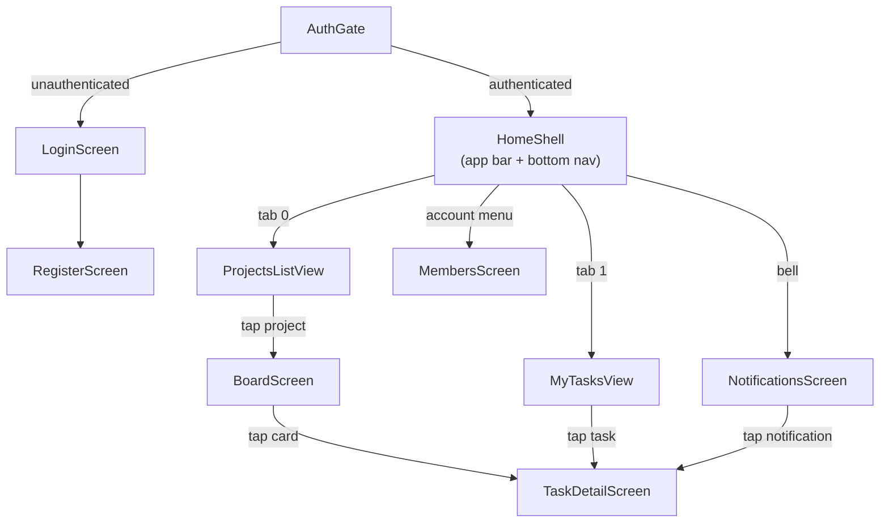
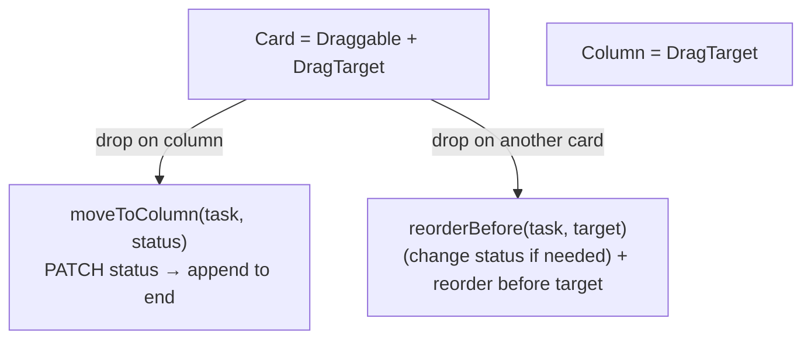

# 13. Frontend Screens & Widgets

This chapter walks the UI: the screens (full pages) and the reusable widgets,
and how you navigate between them.

Files covered: everything in
[`lib/screens/`](../frontend/lib/screens) and
[`lib/widgets/`](../frontend/lib/widgets).

## Navigation map



## AuthGate, Login & Register

- [`auth_gate.dart`](../frontend/lib/screens/auth_gate.dart) — routes on session
  status (covered in [Chapter 11](11-frontend-architecture.md#routing-at-boot--auth_gatedart)).
- [`login_screen.dart`](../frontend/lib/screens/login_screen.dart) — email +
  password form. On submit it calls `AuthService.login`, then
  `SessionController.completeLogin`, and the `AuthGate` rebuilds into the app.
- [`register_screen.dart`](../frontend/lib/screens/register_screen.dart) — name +
  email + password (min 8 chars); same completion path.

Both capture their providers **before** any `await` to avoid using `BuildContext`
across async gaps — a Flutter correctness rule enforced by the analyzer:

```dart
final auth = AuthService(context.read<ApiClient>());
final session = context.read<SessionController>();
final tokens = await auth.login(email: ..., password: ...);
await session.completeLogin(tokens.accessToken, tokens.refreshToken);
```

## HomeShell — the app frame

[`home_shell.dart`](../frontend/lib/screens/home_shell.dart) owns the top app bar
and bottom navigation, and hosts the two tab views in an `IndexedStack`. The app
bar has three global controls:

- **Workspace switcher** (title) — a popup of the user's workspaces plus
  "+ New workspace". Selecting one calls `_switchWorkspace`.
- **Notification bell** — a `Badge` showing the unread count; opens
  `NotificationsScreen`.
- **Account menu** — shows the current email, links to **Members**, and
  **Log out**.

The floating action button is contextual: on the Projects tab it triggers
create-project (via a `GlobalKey<ProjectsListViewState>`); on My Tasks it's
hidden.

### Switching workspaces reloads everything

Because data is per-workspace, switching must refresh every workspace-scoped
provider so no previous tenant's data lingers:

```dart
Future<void> _switchWorkspace(int workspaceId) async {
  final session = context.read<SessionController>();
  if (session.currentWorkspaceId == workspaceId) return;
  final projects = context.read<ProjectsProvider>();
  final upcoming = context.read<UpcomingProvider>();
  final labels = context.read<LabelsProvider>();
  final notifications = context.read<NotificationsProvider>();
  await session.switchWorkspace(workspaceId);   // updates the X-Workspace-Id header source
  await projects.load();
  await upcoming.load();
  await labels.load(force: true);
  await notifications.refreshUnreadCount();
}
```

After this, every subsequent API call carries the new `X-Workspace-Id` (the
`ApiClient` reads it from the session), so the backend scopes results to the new
workspace.

## ProjectsListView

[`projects_list_screen.dart`](../frontend/lib/screens/projects_list_screen.dart)
is a **body-only** view (the shell provides the Scaffold). It:

- lists projects with their `KEY · open/total` subtitle,
- has a "Show archived" toggle bound to `ProjectsProvider.includeArchived`,
- offers a per-project menu (Archive / Unarchive / Delete),
- exposes `showCreateDialog()` publicly so the shell's FAB can open it,
- taps through to the `BoardScreen`.

## BoardScreen — the Kanban board

[`board_screen.dart`](../frontend/lib/screens/board_screen.dart) is the richest
screen. It creates its own `BoardProvider` and loads workspace members for
assignee names:

```dart
ChangeNotifierProvider(
  create: (c) => BoardProvider(TasksService(c.read<ApiClient>()), project.id)..load(),
  child: _BoardView(project: project),
)
```

It has three parts:

1. **Filter bar** — a search field, priority/due dropdowns, label filter chips,
   and a "+ Label" action to create a workspace label inline. Each control calls
   a `BoardProvider.set…` method that reloads the board with new query params.
2. **Three columns** (`To Do`, `In Progress`, `Done`), each a `DragTarget<Task>`.
3. **Cards** — each card is both a `Draggable<Task>` and a `DragTarget<Task>`.

### Drag-and-drop model



- **Drop a card on a column** → move to that column, appended to the end.
- **Drop a card on another card** → insert immediately before that card (a pure
  reorder within a column, or a cross-column move-and-position in one gesture).

This maps onto the backend's two mechanisms from
[Chapter 8](08-projects-tasks-board.md#moving-columns-vs-reordering): `PATCH`
status for column moves, `POST …/reorder` for positioning. An insertion-line
indicator appears above the hovered card.

## TaskDetailScreen

[`task_detail_screen.dart`](../frontend/lib/screens/task_detail_screen.dart) is a
two-tab screen (`Details` / `Activity`):

- **Details** — an editable form (title, description, status, priority,
  **assignee** dropdown populated from workspace members, due date), a **labels**
  editor (multi-select dialog), a **Save** button (one `PATCH`), and the
  **comments** section beneath.
- **Activity** — the `ActivityTimeline` widget.

The assignee dropdown and members list come from `WorkspacesService.members` for
the active workspace. Saving sends `assignee_id`, which the backend validates
against membership and may turn into a notification (see
[Chapter 10](10-assignments-notifications.md)).

## MyTasksView

[`my_tasks_screen.dart`](../frontend/lib/screens/my_tasks_screen.dart) is a
body-only view with a `Today / This Week / All Open` segmented control and an
"Assigned to me only" switch (defaults on). It reads from `UpcomingProvider`,
shows each task's project and key, renders overdue dates in the error color, and
taps through to `TaskDetailScreen`.

## MembersScreen

[`members_screen.dart`](../frontend/lib/screens/members_screen.dart) lists the
active workspace's members. Owner-only controls (guarded by the backend and also
hidden in the UI for non-owners): **Invite** (FAB), and a per-member menu to
**Make owner / Make member / Remove**. It reads `SessionController` to know
whether the current user is an owner (`currentWorkspace.isOwner`).

## NotificationsScreen

[`notifications_screen.dart`](../frontend/lib/screens/notifications_screen.dart)
lists notifications (bold = unread), with a **Mark all read** action. Tapping a
notification marks it read and deep-links to its task's `TaskDetailScreen`. The
unread badge in the shell is refreshed on return.

## Reusable widgets — `lib/widgets/`

| Widget | Used by | Purpose |
|--------|---------|---------|
| [`task_card.dart`](../frontend/lib/widgets/task_card.dart) | board | Card: key, title, label chips, due date (red if overdue), assignee avatar |
| [`label_chip.dart`](../frontend/lib/widgets/label_chip.dart) | detail, board | Colored chip; `labelColor()` parses `#rrggbb` |
| [`comments_section.dart`](../frontend/lib/widgets/comments_section.dart) | task detail | Self-contained comments list + add/edit/delete |
| [`activity_timeline.dart`](../frontend/lib/widgets/activity_timeline.dart) | task detail | Loads and renders the activity log |

`CommentsSection` and `ActivityTimeline` each take a service in their
constructor, so they're self-contained and independently testable — they load
their own data and manage their own `loading`/`error` state rather than relying
on an app-wide provider.

```dart
CommentsSection(taskId: widget.taskId, service: CommentsService(context.read<ApiClient>()))
ActivityTimeline(taskId: widget.taskId, service: ActivityService(context.read<ApiClient>()))
```

## Widget test

[`test/widget_test.dart`](../frontend/test/widget_test.dart) is a boot smoke test:
with a mocked HTTP client and empty secure storage, the app should route through
`AuthGate` to the login screen. See [Chapter 16](16-testing.md#frontend-tests).

---

Previous: [Chapter 12 — Frontend Models, Services & State](12-frontend-models-services-state.md) ·
Next: [Chapter 14 — API Reference](14-api-reference.md)
