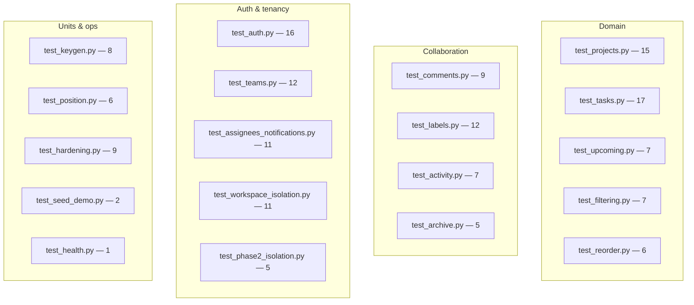

# 16. Testing

Korvexa has a substantial backend test suite (**166 tests, ~92% coverage of
`app/`**) and a frontend smoke test. This chapter explains how the tests are
organized, the fixtures that make them fast and isolated, and how to run them.

## Philosophy

Two principles shape the suite:

1. **Migrations are the source of truth.** Every test builds its database by
   running `alembic upgrade head` — not `create_all`. A broken migration fails
   the suite loudly instead of being silently worked around.
2. **Isolation is a feature under test.** Multi-tenant separation and role
   permissions aren't assumed — they're proven with two-user scenarios.

## Running the tests

```bash
cd backend
pytest                                        # all tests
pytest tests/test_tasks.py                    # one file
pytest -k reorder                             # by name
pytest --cov=app --cov-report=term-missing    # coverage in the terminal
pytest --cov=app --cov-report=html            # HTML report in htmlcov/
```

Config lives in [`backend/pytest.ini`](../backend/pytest.ini) (test paths,
`pythonpath=.`) and coverage in [`backend/.coveragerc`](../backend/.coveragerc)
(source = `app`, omits tests).

## Fixtures — `tests/conftest.py`

[`conftest.py`](../backend/tests/conftest.py) is the backbone. It sets
`BCRYPT_ROUNDS=4` **before** importing the app so hashing is cheap in tests.

### `test_engine` — a fresh migrated database per test

```python
@pytest.fixture()
def test_engine(tmp_path):
    db_url = f"sqlite:///{tmp_path}/test_{uuid4().hex}.db"
    cfg = Config(".../alembic.ini")
    cfg.attributes["configured_url"] = db_url     # env.py reads this
    command.upgrade(cfg, "head")                   # build schema via migrations
    engine = create_engine(db_url, ...)            # + FK pragma
    yield engine
    engine.dispose()
```

Each test gets its **own** SQLite file, built by the real migration chain. This
is what enforces principle #1 above. The `configured_url` attribute is how
[`alembic/env.py`](../backend/alembic/env.py) knows to target the test DB instead
of the app's `DATABASE_URL` (see [Chapter 6](06-data-model-and-migrations.md#envpy--how-alembic-finds-the-schema-and-the-database)).

### Client fixtures

`_make_test_client` overrides the `get_session` dependency to use the test
engine and disables the rate limiter:

```python
app.dependency_overrides[get_session] = _override_get_session
app.state.limiter.enabled = False
```

There are three client-shaped fixtures:

| Fixture | Auth state | Use it for |
|---------|-----------|-----------|
| `raw_client` | unauthenticated | Auth endpoints and 401 tests |
| `client` | **authenticated** as a default owner + personal workspace | Most tests |
| `register_client` | factory to register *more* users on the same DB | Two-user / role tests |

The `client` fixture registers `owner@example.com`, sets default
`Authorization` + `X-Workspace-Id` headers, and stashes the context on
`client.auth_context`:

```python
ctx = register_user(client, "owner@example.com", "Workspace Owner")
client.headers.update(ctx["headers"])
client.auth_context = ctx     # workspace_id, tokens, etc.
```

**Why this matters:** because `client` is authenticated by default, all the Phase
1–2 tests (written before auth existed) still hit the same endpoints unchanged —
demonstrating the "team-later seam" from [Chapter 7](07-auth-and-multitenancy.md)
at the test level.

## What's covered — by file



Highlights:

- **`test_workspace_isolation.py` / `test_phase2_isolation.py`** — insert a
  *second* workspace directly at the DB layer and prove the authenticated client
  can't read, write, list, or even detect it (always `404`), across projects,
  tasks, comments, labels, and activity.
- **`test_teams.py`** — real two-user scenarios: invites, claiming placeholders,
  role enforcement (member can't delete a project or invite; owner can),
  promotion, and workspace switching.
- **`test_auth.py`** — register/login/refresh/me happy paths plus the failure
  matrix: duplicate email, wrong password, unknown email, expired token, invalid
  token, refresh-token-used-as-access rejection.
- **`test_reorder.py`** — reorder *stability*: moving one card leaves the other
  cards' `position` values untouched.
- **`test_hardening.py`** — error-envelope shape, `X-Request-ID` header (incl.
  echoing an inbound id), the `429` from rate limiting, and validation clamps.
- **`test_keygen.py` / `test_position.py`** — pure unit tests of the key
  derivation and fractional-rank helpers (no DB, no client).

Every backend endpoint has both happy-path and failure-case coverage
(validation, not-found, ownership/permission), per the project's working
agreement.

## A representative test

Two-user isolation reads clearly thanks to the fixtures:

```python
def test_user_b_cannot_see_user_a_workspace(client, register_client):
    project = client.post("/projects", json={"name": "Secret A"}).json()   # user A
    b = register_client("b@example.com", "Bob")                            # user B
    assert client.get("/projects", headers=b["headers"]).json() == []       # B sees nothing
    assert client.get(f"/projects/{project['id']}", headers=b["headers"]).status_code == 404
```

## Frontend tests

```bash
cd frontend
flutter analyze     # static analysis — should report no issues
flutter test        # widget tests
```

[`test/widget_test.dart`](../frontend/test/widget_test.dart) is a boot smoke
test. It uses `MockClient` (so no network) and `FlutterSecureStorage.setMockInitialValues({})`
(so no stored token), then asserts the app routes through `AuthGate` to the
**login screen**:

```dart
FlutterSecureStorage.setMockInitialValues({});
await tester.pumpWidget(KorvexaApp(httpClient: mockClient));
await tester.pumpAndSettle();
expect(find.text('Log in'), findsOneWidget);
```

The injectable `httpClient` on `KorvexaApp` (see [Chapter 11](11-frontend-architecture.md))
is what makes this hermetic.

## Performance note

The suite runs in ~1.5–3 minutes. The cost is dominated by running the migration
chain once per test (the isolation guarantee) plus bcrypt on each registration
(mitigated by `BCRYPT_ROUNDS=4`). This is a deliberate correctness-over-speed
trade-off.

---

Previous: [Chapter 15 — Configuration Reference](15-configuration-reference.md) ·
Next: [Chapter 17 — Deployment](17-deployment.md)
