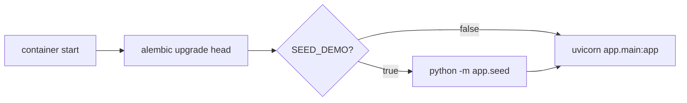

# 17. Deployment

This chapter covers building and shipping both halves: the backend as a Docker
image (with migrations that run on start) and the Flutter app for web and native
targets.

Files covered:
[`backend/Dockerfile`](../backend/Dockerfile),
[`backend/entrypoint.sh`](../backend/entrypoint.sh),
[`docker-compose.yml`](../docker-compose.yml).

## The core deploy principle

**Migrations run automatically on container start.** The image's entrypoint runs
`alembic upgrade head` before serving, so every deploy converges the schema to
head — you never run migrations by hand in production.

## The backend image — `Dockerfile`

[`backend/Dockerfile`](../backend/Dockerfile) is a standard slim-Python image:

```dockerfile
FROM python:3.12-slim
ENV PYTHONUNBUFFERED=1 PYTHONDONTWRITEBYTECODE=1 PIP_NO_CACHE_DIR=1
WORKDIR /app
COPY requirements.txt .
RUN pip install --no-cache-dir -r requirements.txt   # psycopg2-binary ships wheels, no build tools needed
COPY . .
RUN chmod +x ./entrypoint.sh
EXPOSE 8000
ENTRYPOINT ["./entrypoint.sh"]
```

It installs only the runtime `requirements.txt` (not the `-dev` extras).

## The entrypoint — `entrypoint.sh`

```sh
set -e
alembic upgrade head                     # 1. converge schema
if [ "${SEED_DEMO:-false}" = "true" ]; then
  python -m app.seed || echo "Seed skipped/failed (non-fatal)."   # 2. optional demo data
fi
exec uvicorn app.main:app --host 0.0.0.0 --port "${PORT:-8000}"    # 3. serve
```



`PORT` defaults to 8000; `SEED_DEMO` defaults to off. `set -e` means a failed
migration aborts the boot (fail fast) — but a failed *seed* is non-fatal.

## Docker Compose (self-host) — `docker-compose.yml`

Compose brings up the API **and** a Postgres database:

```yaml
services:
  db:
    image: postgres:16-alpine
    environment: { POSTGRES_USER: korvexa, POSTGRES_PASSWORD: korvexa, POSTGRES_DB: korvexa }
    healthcheck: pg_isready ...
  api:
    build: ./backend
    depends_on: { db: { condition: service_healthy } }
    environment:
      DATABASE_URL: postgresql+psycopg2://korvexa:korvexa@db:5432/korvexa
      SECRET_KEY: ${SECRET_KEY:-change-me-in-production}
      CORS_ORIGINS: '["*"]'
      SEED_DEMO: ${SEED_DEMO:-false}
    ports: ["8000:8000"]
```

Run it:

```bash
# Build the API image and start api + Postgres (API on :8000).
SECRET_KEY=$(openssl rand -hex 32) docker compose up --build

# With demo data on first boot:
SEED_DEMO=true SECRET_KEY=$(openssl rand -hex 32) docker compose up --build
```

- The API waits for the DB's healthcheck (`depends_on: condition: service_healthy`).
- `SECRET_KEY` is taken from your shell (falls back to a placeholder — **set it**
  for anything real).
- For local dev where you run `uvicorn` yourself, start only the database:
  `docker compose up -d db`, and point your local `DATABASE_URL` at
  `localhost:5432`.

> **Not yet verified in this environment:** the image build wasn't executed here
> because no Docker daemon was available. `docker compose config` validates the
> compose file, and the Dockerfile is standard — but run `docker compose up
> --build` once yourself to confirm on your machine.

## Cloud targets

All three PaaS options build from `backend/Dockerfile`. Set these env vars
(see [Chapter 15](15-configuration-reference.md)):

| Var | Value |
|-----|-------|
| `DATABASE_URL` | `postgresql+psycopg2://…` (managed Postgres or Supabase) |
| `SECRET_KEY` | long random string (`openssl rand -hex 32`) |
| `CORS_ORIGINS` | JSON array of your web origin(s), e.g. `["https://app.example.com"]` |
| `RATE_LIMIT_AUTH` | optional (default `10/minute`) |

- **Fly.io** — `fly launch --dockerfile backend/Dockerfile`; attach a database
  with `fly postgres create` + `fly postgres attach`; `fly deploy`. Migrations
  run on each release via the entrypoint.
- **Railway** — point a service at `backend/`, add the Postgres plugin (it
  injects a connection string — prefix it with `postgresql+psycopg2://`), set
  `SECRET_KEY`.
- **Render** — a Web Service from `backend/Dockerfile` + a Render Postgres
  instance; set the env vars above.

## Supabase (managed Postgres)

Copy the connection string from **Database → Connection string → URI**, change
the scheme to `postgresql+psycopg2://`, and set it as `DATABASE_URL`. No code
changes — the entrypoint runs `alembic upgrade head` against it on boot. (For a
one-off manual build, run `alembic upgrade head` locally against the same URL.)

## Frontend builds

The app reads its API base URL from `--dart-define=API_BASE_URL=…` (see
[Chapter 15](15-configuration-reference.md#frontend-configuration)).

```bash
cd frontend

# Web — static output in build/web/ (serve via Netlify, Nginx, Cloudflare Pages, …)
flutter build web --release --dart-define=API_BASE_URL=https://api.example.com

# Windows desktop (a native target)
flutter build windows --release --dart-define=API_BASE_URL=https://api.example.com

# Android
flutter build apk --release --dart-define=API_BASE_URL=https://api.example.com
```

> **Web note:** `flutter_secure_storage_web` uses `dart:js_util`, which isn't
> compatible with the experimental Wasm build. Use the **default JS build**
> (shown above), not `--wasm`.

## Production checklist

- [ ] `SECRET_KEY` set to a strong random value (rotating it logs everyone out).
- [ ] `DATABASE_URL` points at managed Postgres/Supabase, not SQLite.
- [ ] `CORS_ORIGINS` restricted to your real web origin(s), not `["*"]`.
- [ ] `BCRYPT_ROUNDS` at its default (12) or higher.
- [ ] `SEED_DEMO` **off**.
- [ ] Serve over HTTPS (tokens are bearer tokens — see [Chapter 18](18-security.md)).
- [ ] Frontend built with the production `API_BASE_URL`.

---

Previous: [Chapter 16 — Testing](16-testing.md) ·
Next: [Chapter 18 — Security Considerations](18-security.md)
