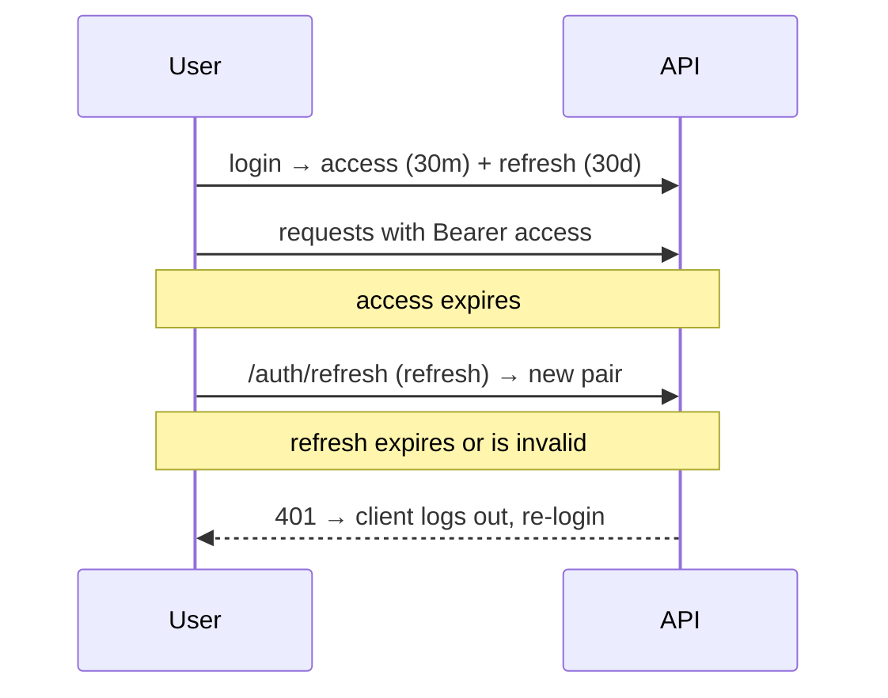

# 18. Security Considerations

This chapter collects Korvexa's security model in one place: how authentication
works, how tenant isolation is enforced, where secrets live, and the known
sensitive areas to be aware of when self-hosting.

## Authentication model

- **Passwords** are hashed with **bcrypt** (work factor `BCRYPT_ROUNDS`, default
  12) and never stored in plaintext. Verification is constant-time via
  `bcrypt.checkpw`. See [Chapter 7](07-auth-and-multitenancy.md#passwords-bcrypt).
- **Tokens** are JWTs signed with `SECRET_KEY` (HS256). Two types:
  - **access** (default 30 min) — sent as `Authorization: Bearer …` on every
    request.
  - **refresh** (default 30 days) — exchanged at `/auth/refresh` for a new pair.
  - `decode_token` enforces the token `type`, so a refresh token cannot be used
    as an access token (tested in `test_auth.py`).
- **Login is not user-enumerable** — the same `401 "Invalid email or password"`
  is returned whether the email is unknown or the password is wrong.

## Tenant isolation (the most important property)

Every data row is scoped by `workspace_id`, and **every** request resolves the
active workspace and checks membership before touching data:

- `get_current_workspace` requires that the user is a member of the requested
  workspace ([Chapter 7](07-auth-and-multitenancy.md#the-seam--depspy)).
- Each resource fetch re-checks `row.workspace_id == workspace.id` (e.g.
  `get_project_or_404`, `get_task_or_404`), and returns an indistinguishable
  **`404`** for "missing" and "not yours" — you can't even confirm another
  tenant's data exists.
- Cross-cutting writes validate tenancy too: assignees must be workspace members
  (`_validate_assignee`), and labels attached to a task must belong to the same
  workspace (`set_task_labels`).

This isn't just convention — it's proven by dedicated isolation test suites
(`test_workspace_isolation.py`, `test_phase2_isolation.py`, `test_teams.py`); see
[Chapter 16](16-testing.md).

## Authorization (roles)

- Two roles: `owner` and `member`.
- Owner-only actions are guarded by `require_owner` (a `403` otherwise): deleting
  a project, and inviting / removing / re-roling members.
- An owner **cannot remove themselves**, so a workspace can't be orphaned.

## Rate limiting

`/auth/register` and `/auth/login` are rate-limited per client IP via slowapi
(`RATE_LIMIT_AUTH`, default `10/minute`), returning `429` when exceeded. This
blunts brute-force and credential-stuffing attempts. Other endpoints are not
rate-limited by default.

## Secrets management

| Secret | Where it lives | Guidance |
|--------|----------------|----------|
| `SECRET_KEY` | env var | Strong random value in prod; rotating it invalidates all tokens. Never commit it. |
| Database credentials | `DATABASE_URL` env var | Keep out of source control; use your platform's secret store. |
| `.env` files | `backend/.env` | Git-ignored; only `.env.example` (placeholders) is committed. |

No secrets are hard-coded in the application code. The default `SECRET_KEY`
(`dev-secret-change-me`) is a **development placeholder** — treat any deployment
that still uses it as insecure.

## Transport security

Tokens are **bearer tokens**: anyone holding one can act as that user until it
expires. Therefore:

- **Serve the API over HTTPS in production.** Without TLS, tokens can be
  intercepted.
- Set `CORS_ORIGINS` to your specific web origin(s) in production rather than
  `["*"]`, so browsers only allow your frontend to call the API with credentials.

## Token storage on the client

The Flutter app stores tokens with `flutter_secure_storage`
([Chapter 11](11-frontend-architecture.md#secure-storage--token_storagedart)):

- **Native** (mobile/desktop) — OS keychain/keystore.
- **Web** — an encrypted IndexedDB store. Note that browser storage is inherently
  more exposed than a native keychain (e.g. to XSS); this is a standard trade-off
  for web SPAs. Keep the app free of untrusted third-party scripts.

## Known sensitive areas / assumptions

- **@mention matching is heuristic.** `notify_mentions` matches a handle to the
  email local-part or the squashed name, case-insensitively. Colliding handles
  in one workspace would both match. It only ever notifies *members of that
  workspace*, so there's no cross-tenant leak, but it isn't a curated-username
  system. See [Chapter 10](10-assignments-notifications.md#mentions).
- **Email is a stub.** `send_email` only logs. If you wire up a real provider,
  treat notification/message content (which includes user-supplied task titles
  and names) as untrusted input and escape/encode it appropriately for the email
  medium.
- **No email verification / password reset flow.** Registration trusts the
  provided email; there's no confirmation step or self-service reset in the
  current code. Add these before exposing Korvexa to untrusted signups.
- **No account lockout** beyond IP rate limiting on auth endpoints.
- **`X-Request-ID` is client-influenced.** An inbound request id is honored and
  echoed for tracing. It's used only for logging/correlation, never for
  authorization, so this is safe — but don't treat it as trusted.

## Defense-in-depth already present

- Foreign-key constraints + cascades enforce referential integrity at the DB
  (with the SQLite FK pragma making SQLite behave like Postgres).
- Uniqueness constraints prevent duplicate memberships, project keys, task
  numbers, and label names at the schema level.
- The consistent error envelope avoids leaking stack traces; unhandled
  exceptions return a generic `500` with only a `request_id`.

---

Previous: [Chapter 17 — Deployment](17-deployment.md) ·
Next: [Chapter 19 — Troubleshooting & FAQ](19-troubleshooting-faq.md)
